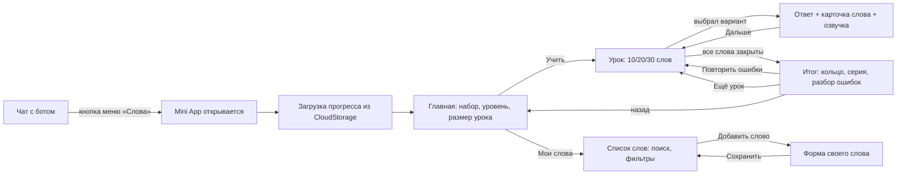

# 01. Продукт

## Для кого и зачем

**Кому.** Русскоязычному взрослому с английским примерно на уровне B1–B2. Он хочет расширить словарь для работы и созвонов и тратит на это по 5–10 минут в день прямо в Telegram, без отдельного приложения и регистрации. Это видно по самому продукту: переводы и интерфейс на русском, тематические наборы «Работа и IT», «Встречи», «Фразовые», примеры из рабочей речи («We can't afford another delay before the launch»).

**Зачем.** Чтобы слова не просто узнавались, а оставались в памяти. Для этого в продукте:
- **интервальные повторения** по Лейтнеру: слово возвращается через 1, 3, 7, 16 и 35 дней;
- **честные варианты ответа**: неправильные варианты той же части речи и уровня, ответ не угадать по грамматике;
- **ловушки ложных друзей**: для `magazine` среди вариантов обязательно стоит «магазин»;
- **полная карточка слова** после каждого ответа: значения, транскрипция, звук, пример, сочетаемость.

**Происхождение.** README называет проект «Личное приложение: без бэкенда, без аккаунтов, без аналитики и рекламы». Сделано для себя, пользоваться может любой, кто откроет бота.

## Роли пользователей

| Роль | Есть ли | Что может |
|---|---|---|
| **Ученик** | Да, единственная роль в приложении | Всё: учить, смотреть свои слова, добавлять и удалять свои слова, менять настройки |
| Администратор, модератор, преподаватель | Нет | В коде нет ни ролей, ни проверки `user.id`, ни админки. Приложение не знает, кто его открыл: `initDataUnsafe.user` не читается |
| **Сопровождающий** (разработчик) | Вне приложения | Правит словарь и код в репозитории, настраивает бота в BotFather. До данных пользователей доступа не имеет: CloudStorage читается только из Mini App этого пользователя ([14](14-runbooks.md#сбросить-прогресс-пользователя-по-его-просьбе)) |

Все пользователи видят один и тот же словарь. Прогресс, статистика, настройки и свои слова у каждого свои: CloudStorage выделяется на пару «бот + пользователь Telegram».

## Как устроено обучение целиком

1. **Вход.** В чате с ботом пользователь нажимает кнопку меню слева от поля ввода (подпись задаётся в BotFather, по README — «Слова»). Telegram открывает `https://dreamo-pg.github.io/english-words/` во встроенном окне.
2. **Загрузка.** Приложение разворачивается на всю высоту, красит шапку и фон в светлый `#FAF9F5` и читает из CloudStorage настройки, прогресс, статистику и свои слова. Пока данные не прочитаны, учить нельзя. Если загрузка длится дольше 400 мс, появляется надпись «Загружаю прогресс…». Если чтение не удалось, показывается экран «Не удалось загрузить прогресс» с кнопкой «Повторить».
3. **Главная.** Три счётчика: «знаю», «на повторе», «дней подряд». Ниже выбор набора (По уровню / Работа и IT / Встречи / Фразовые), уровня (сейчас только B1 и B2) и числа слов в уроке (10 / 20 / 30). Каждое изменение сразу сохраняется. Кнопка «Учить».
4. **Урок.** Сверху полоса прогресса «N / M». Крупно английское слово, транскрипция, кнопка звука, чипы «часть речи» и «уровень». Ниже четыре варианта русского перевода. Пользователь нажимает вариант:
   - верный — вибрация «успех», заголовок «Верно», вариант подсвечивается зелёным;
   - неверный — вибрация «ошибка», заголовок «Не угадал», выбранный вариант красный, верный зелёный.
   Снизу выезжает карточка слова, слово произносится вслух. Кнопка «Дальше». Слово с ошибкой вернётся через 2–3 карточки. Урок кончается, когда каждое слово хотя бы раз отвечено верно.
5. **Итог.** Кольцо «сколько слов с первого раза из скольких», серия дней с огоньком, «Разбор ошибок» (слово, транскрипция, значения, точки усвоения, звук). Кнопки «Повторить ошибки» (если ошибки были) и «Ещё урок». Прогресс к этому моменту уже поставлен в очередь записи в облако.
6. **Дальше по дням.** На следующий день на главной растёт «на повторе». Следующий урок сначала берёт слова с наступившим сроком (самые просроченные первыми), остальное добирает новыми словами. Новое слово, четыре раза подряд отвеченное верно в срок (минимум за 26 дней), попадает в «знаю» (box 5), но через 35 дней снова придёт на проверку.
7. **Мои слова.** Список всех слов словаря и своих слов: поиск по английскому и русскому, фильтры «Все / Учу / Знаю / Трудные», точки усвоения у каждого слова. По нажатию раскрывается карточка слова. Внизу «Добавить слово»: форма со словом, переводами через запятую, частью речи и примером. Своё слово попадает в уроки текущего уровня наравне со словарными.

Подробная логика — в [02](02-learning-logic.md), экраны и все их состояния — в [06](06-mini-app-screens.md).

## Как заниматься в чате

**Никак.** У бота нет серверного кода, поэтому он не отвечает ни на `/start`, ни на любые сообщения, ни на кнопки. В чате пользователь видит только то, что настроено в BotFather:
- описание бота (`/setdescription`), которое видно до первого сообщения. README предлагает текст: «Тренажёр английских слов B1–B2. Нажмите кнопку «Слова» внизу, чтобы начать.»;
- строку «о боте» в профиле (`/setabouttext`);
- аватар (`assets/bot-icon.png`, знак МФА «шва» на бирюзовом фоне);
- **кнопку меню** (Menu Button) с подписью «Слова», которая открывает Mini App.

Какие тексты на самом деле стоят в BotFather у боевого бота, **не проверено**: у документации нет доступа к BotFather, тексты выше — рекомендации из README. Подробнее — [04](04-bot-in-telegram.md).

## Как заниматься в Mini App

Всё обучение идёт в Mini App. Короткая памятка пользователю, составленная по коду:

- **Открыть** — кнопка меню «Слова» в чате с ботом. На Telegram с Mini Apps 8.0+ на главной может появиться плашка «На домашний экран»: она добавляет иконку приложения на экран телефона, и тогда бота искать не нужно.
- **Выбрать, что учить**: набор, уровень, сколько слов. Выбор запоминается и переносится на другие устройства.
- **Учить** каждый день. Серия «дней подряд» растёт, если урок был вчера и сегодня. День сменяется в местную полночь.
- **Сколько угодно уроков в день.** Дневного лимита нет. Если повторять нечего и новые слова кончились, урок всё равно соберётся из «отдыхающих» слов. Такие уроки — тренировка: на box они не влияют, пока не наступил срок.
- **Не уходить из начатого урока**, если жалко ответов: прогресс урока пишется только в конце. Кнопка «назад» и закрытие окна посреди урока спрашивают «Выйти из урока? Ответы этого урока не сохранятся.»
- **Работать на нескольких устройствах можно.** Прогресс лежит в облаке Telegram, а при записи версии с разных устройств сливаются по слову. Статистика (серия, счётчики) сливается грубее, побеждает последняя запись ([16](16-issues-backlog.md)).
- **Без интернета** прогресс урока сохраняется на устройстве и досылается позже. Сверху появляется плашка «Не всё сохранено в облако…» с кнопкой «Повторить».

## Ограничения продукта, о которых стоит знать

- Слова есть только для **B1** и **B2**. Уровни A1, A2, C1 предусмотрены в типах (`LEVELS`), но слов для них нет, и на главной они не показываются.
- Упражнение одно: **английское слово → выбрать русский перевод из четырёх**. Ввода слова, обратного направления и аудирования нет.
- Озвучка зависит от синтеза речи устройства (`speechSynthesis`). Голос американский (`en-US`), а транскрипции в словаре британские. Если синтеза нет, кнопки звука просто не рисуются.
- Тема всегда светлая, даже в тёмном Telegram.
- Нужна версия Mini Apps 6.9+ (CloudStorage). На более старых клиентах вместо приложения показывается экран «Обновите Telegram».
- Бот не пишет первым: напоминаний нет.
