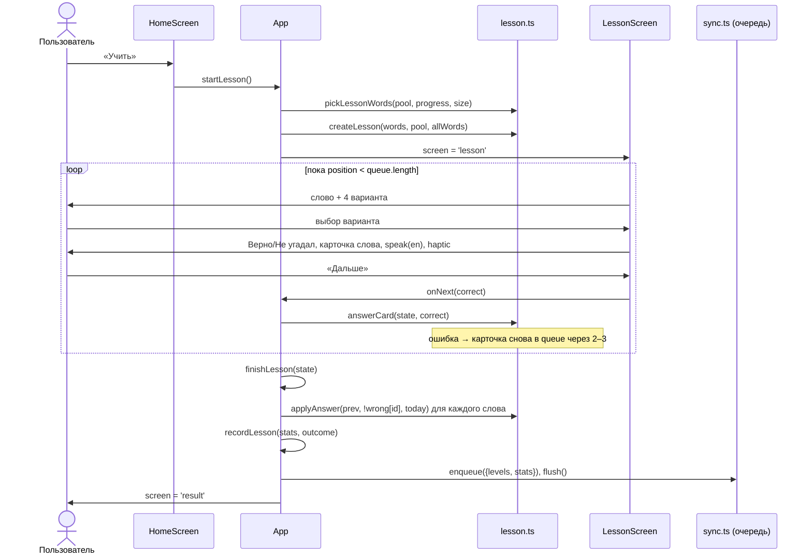
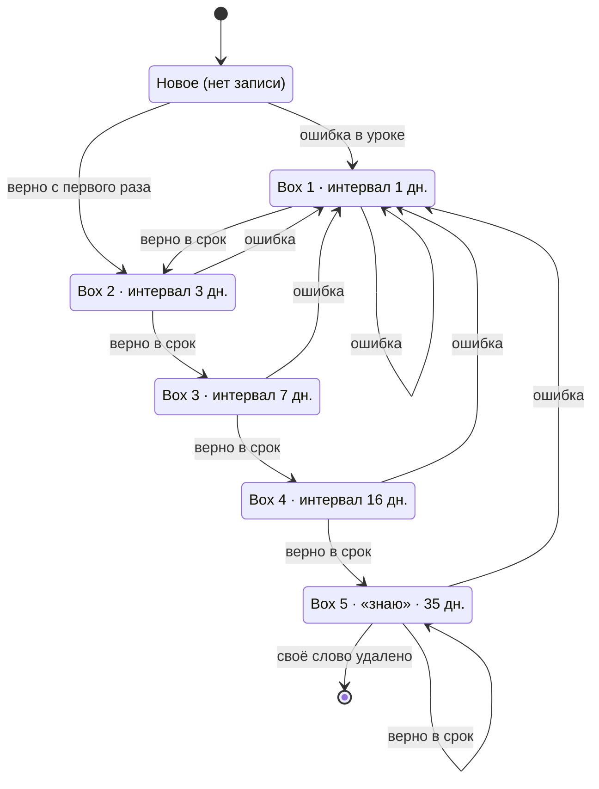

# 02. Логика обучения

Весь «движок» — чистые функции без обращения к сети, их можно вызывать в тестах:

| Файл | Что внутри |
|---|---|
| [`src/lib/lesson.ts`](../../src/lib/lesson.ts) | `poolFor`, `pickLessonWords`, `buildCard`, `createLesson`, `currentCard`, `answerCard`, `isLessonOver`, `lessonMistakes` |
| [`src/lib/leitner.ts`](../../src/lib/leitner.ts) | `INTERVALS`, `MAX_BOX`, `dayOf`, `today`, `isDue`, `overdueBy`, `applyAnswer`, `boxTone` (не используется) |
| [`src/lib/stats.ts`](../../src/lib/stats.ts) | `recordLesson`, `currentStreak`, `summarize` |
| [`src/App.tsx`](../../src/App.tsx) | Склейка: `startLesson`, `handleAnswer`, `finishLesson`, `startRepeat` |

Проверяет движок `npm run check:engine` ([`scripts/check-engine.mjs`](../../scripts/check-engine.mjs), 56 проверок, см. [13](13-development.md#проверки)).

## Константы

| Константа | Значение | Где | Смысл |
|---|---|---|---|
| `INTERVALS` | `[1, 3, 7, 16, 35]` | `leitner.ts` | Дней до следующего показа для box 1, 2, 3, 4, 5 |
| `MAX_BOX` | `5` | `leitner.ts` | Box выше 5 не растёт |
| `DAY_EPOCH` | `Date.UTC(2020, 0, 1)` | `leitner.ts` | Начало отсчёта дней |
| `DAY_MS` | `86 400 000` | `leitner.ts` | Миллисекунд в сутках |
| `REVIEW_FLIP` | `30` | `lesson.ts` | Если повторов больше 30, пропорция урока переворачивается |
| Доля повторов | `0.3` или `0.7` | `lesson.ts` `pickLessonWords` | 30 % повторов обычно, 70 % при завале |
| Возврат ошибки | `gap = 2 + random(0..1)` | `lesson.ts` `answerCard` | Ошибочная карточка вставляется на 2 или 3 позиции вперёд |
| Размер урока | `10 \| 20 \| 30`, по умолчанию `20` | [`src/lib/settings.ts`](../../src/lib/settings.ts) `Settings`, `DEFAULT_SETTINGS` | Сколько разных слов в уроке |
| Порог «знаю» | `box >= 5` | `stats.ts` `summarize`, `WordsScreen` | Слово считается выученным |
| Порог «трудные» | `errors >= 2` | [`src/screens/WordsScreen.tsx`](../../src/screens/WordsScreen.tsx) | Фильтр «Трудные» |
| `HISTORY_LIMIT` | `20` | `stats.ts` | Сколько последних уроков хранится в истории |
| Потолок ошибок при записи | `99` | [`src/lib/progress.ts`](../../src/lib/progress.ts) `serializeLevelProgress` | `errors` пишется как `min(99, errors)` |

## Как считается «день»

```ts
dayOf(ms, offsetMinutes) = floor((ms − offsetMinutes·60 000 − DAY_EPOCH) / DAY_MS)
today() = dayOf(Date.now(), new Date().getTimezoneOffset())
```

День — целое число от 2020-01-01 **по местной полуночи устройства**. Для Москвы `getTimezoneOffset() = −180`, поэтому урок в 00:30 МСК — это уже новый день. До аудита день считался по UTC (находка L-08). У старых записей поэтому возможен сдвиг на день, это безвредно.

Следствие: если у пользователя устройства в разных часовых поясах, «сегодня» на них может отличаться на день. Отдельно это не обрабатывается.

## Модель прогресса слова

```ts
type WordProgress = { box: number /* 1–5 */; errors: number; lastDay: number };
type LevelProgress = Record<string /* id слова */, WordProgress>;
type Progress = Partial<Record<Level, LevelProgress>>;
```

Записи нет — слово **новое**. Запись создаётся только в конце урока, в котором слово участвовало.

## Подбор слов для урока

### 1. Пул: `poolFor(words, set, level)`

- `words` — словарь (`WORDS`) плюс свои слова пользователя (`App.allWords`).
- Набор `level` («По уровню»): все слова выбранного уровня.
- Тематический набор (`it-work`, `meetings`, `phrasal`): слова этого набора **и** выбранного уровня. До аудита уровень игнорировался (L-07).
- Свои слова входят в набор «По уровню» своего уровня. В тематические наборы они не входят: у них `sets = ['custom']`.

Размеры пулов:

| Набор | B1 | B2 |
|---|---|---|
| По уровню (`level`) | 200 (+ свои B1) | 240 (+ свои B2) |
| Работа и IT (`it-work`) | 65 | 124 |
| Встречи (`meetings`) | 33 | 55 |
| Фразовые (`phrasal`) | 20 | 30 |

Подсчитано по `.cache/words.mjs` после `npm run check:words`.

**Действующий уровень.** В настройках может лежать уровень без слов (например, `A1` из старой версии или уровень, где были только удалённые свои слова). `App` берёт `level = settings.level`, если в нём есть слова, иначе первый уровень со словами, иначе `B1`. Сами настройки при этом не перезаписываются.

### 2. Разбиение пула: `pickLessonWords(pool, progress, size, day)`

Каждое слово пула попадает в одну из трёх групп:

| Группа | Условие | Порядок |
|---|---|---|
| `fresh` (новые) | Записи прогресса нет | Перемешаны (Фишер–Йетс) |
| `due` (повторы) | Запись есть и `isDue` | По убыванию `overdueBy`, при равенстве по возрастанию `box` |
| `resting` (отдыхают) | Запись есть, срок не наступил | Перемешаны, только для добора |

### 3. Квоты

```text
reviewShare = (|due| > 30) ? 0.7 : 0.3
wantReview  = round(size × reviewShare)
picked      = due[0 : wantReview] + fresh[0 : size − min(wantReview, |due|)]
```

Если `picked` меньше `size`, урок добирается по порядку из оставшихся `due`, затем `fresh`, затем перемешанных `resting`, пока не наберётся `size` или не кончится пул. Готовый список ещё раз перемешивается, поэтому повторы и новые в уроке идут вперемешку.

Примеры для `size = 20`:

| Повторов | Новых | Отдыхают | В уроке |
|---|---|---|---|
| 0 | 200 | 0 | 20 новых (первый урок) |
| 5 | 150 | 30 | 5 повторов + 15 новых (`wantReview = 6`, но повторов только 5) |
| 12 | 100 | 50 | 6 повторов + 14 новых, ещё 6 повторов ждут следующего урока |
| 40 | 100 | 20 | 14 повторов + 6 новых (переворот: повторов больше 30) |
| 40 | 0 | 0 | 14 повторов, добор ещё 6 повторов = 20 повторов |
| 3 | 0 | 197 | 3 повтора + 17 отдыхающих (тренировка) |
| — | — | — | пул 20 слов («Фразовые» B1) при `size = 30`: в уроке 20 слов |

Новые слова не вытесняют просроченные (до аудита вытесняли, L-05): повторы набираются первыми, а самые просроченные стоят в начале очереди. Слово, просроченное на полгода, не потеряется среди 40 вчерашних ошибок (это проверяет `check:engine`).

## Варианты ответа

`buildCard(word, pool, all)` в `lesson.ts` строит четыре варианта.

1. **Верный вариант** — `word.ru[0]`, первое (основное) значение. Остальные значения видны на карточке после ответа.
2. **Запрещённые тексты** (`used`): все значения `word.ru` в нормализованном виде (`trim().toLowerCase()`). Ни один неправильный вариант не может совпасть ни с одним значением слова. До аудита сравнивалось только с `ru[0]`, и 16 карточек засчитывали верный перевод как ошибку (L-02, полный список в [15](15-history.md#аудит)).
3. **Ложный друг первым.** Если у слова есть `falseFriendRu` и оно не совпадает со значением слова, оно гарантированно попадает в варианты.
4. **Дистракторы** — `ru[0]` других слов, кандидаты по приоритету:
   1. слова пула той же части речи и того же уровня (перемешаны);
   2. все слова (словарь + свои) той же части речи и уровня;
   3. все слова той же части речи любого уровня;
   4. любые слова (для своих «выражений», которых в словаре нет; до аудита у такого слова мог быть 1 вариант, L-06).

   Кандидат пропускается, если его текст уже есть в `used`. Набираем, пока неправильных вариантов не станет 3.
5. Четыре варианта перемешиваются, `correctIndex` — позиция верного.

Почему так: если среди трёх существительных стоит один прилагательный «прилежный», ответ угадывается по грамматике. Поэтому дистракторы той же части речи и уровня.

`check:engine` прогоняет все 440 слов × 30 раз и проверяет, что вариантов ровно 4, они различны, `correctIndex` верен, дистракторы той же части речи и уровня, ни один неправильный не входит в `word.ru`, а ложное значение есть всегда (24 слова × 50 прогонов).

## Режимы упражнений

**Режим один: выбор перевода.** Показывается английское слово (`en`), транскрипция (`ipa`, если есть), чипы части речи и уровня, кнопка озвучки. Под ними четыре варианта на русском, нужно выбрать верный.

Чего нет (проверено по `src/screens/LessonScreen.tsx`, другого экрана упражнения нет):
- перевода с русского на английский;
- ввода слова с клавиатуры;
- аудирования (озвучка только подсказка, слово видно всегда);
- флеш-карточек «помню / не помню» с самооценкой.

После ответа тот же экран переходит во вторую фазу: «Верно» / «Не угадал», варианты с подсветкой и **карточка слова** ([06](06-mini-app-screens.md#урок)). Слово произносится один раз автоматически.

## Ход урока

```ts
type LessonState = {
  cards: LessonCard[];          // по карточке на каждое слово
  queue: number[];              // индексы карточек в порядке показа
  position: number;             // какой элемент queue показывается
  done: number;                 // сколько ответов было верными
  wrong: Record<string, number> // id слова → сколько раз ошибся в этом уроке
};
```

- `createLesson(words, pool, all)`: по карточке на слово, `queue = [0, 1, …, n−1]`.
- `currentCard(state) = cards[queue[position]]`.
- `answerCard(state, correct)`:
  - верно — `position + 1`, `done + 1`;
  - неверно — `wrong[id] + 1`, та же карточка вставляется в `queue` на позицию `min(position + gap, queue.length)`, где `gap` равно 2 или 3 случайно. Карточка вернётся 2-й или 3-й после текущей (между ними 1–2 других). Если очередь кончается раньше, карточка встаёт в конец (у последней карточки — сразу следующей). `position + 1`.
- `isLessonOver(state) = position ≥ queue.length`. Каждая ошибка добавляет показ, поэтому урок кончается, только когда **каждое слово отвечено верно хотя бы раз**.
- Полоса прогресса показывает `done / cards.length`, то есть сколько слов закрыто.



## Конец урока

`finishLesson(state)` в `App.tsx`, вызывается один раз, когда `isLessonOver`.

1. Для **каждого слова урока** (не каждого ответа) вызывается `applyAnswer(prev, correct = !wrong[id], today)`. Ошибся хотя бы раз — для Лейтнера это ошибка, даже если потом ответил верно.
2. Статистика: `recordLesson(stats, outcome, day)`, где
   - `size` — слов в уроке (`cards.length`);
   - `firstTry` — слов без ошибок (`size − число слов в wrong`);
   - `answers` — всего показов (`queue.length`);
   - `wrongAnswers` — сумма `wrong`.
3. Изменённые уровни и новая статистика кладутся в очередь записи (`enqueue`) и отправляются (`flush`). Подробно — [07](07-mini-app-tech.md#хранение-и-синхронизация).
4. Экран переключается на `result`.

**Прерванный урок не сохраняется вообще.** Ни box, ни статистика не меняются. Поэтому при выходе посреди урока спрашивается подтверждение ([06](06-mini-app-screens.md#кнопка-назад-и-подтверждения)).

## Интервальные повторения (Лейтнер)

### Формулы

```text
isDue(p, day)     ⇔ day − p.lastDay ≥ INTERVALS[p.box − 1]
overdueBy(p, day) = day − p.lastDay − INTERVALS[p.box − 1]

applyAnswer(prev, correct, day):
  если не correct:                     → { box: 1, errors: (prev?.errors ?? 0) + 1, lastDay: day }
  если prev есть и не isDue(prev, day): → prev без изменений
  иначе:                               → { box: min(5, (prev?.box ?? 1) + 1), errors: prev?.errors ?? 0, lastDay: day }
```

| Box | Интервал до следующего показа | Точки на карточке (`ProgressDots`) |
|---|---|---|
| — (нет записи) | слово новое | 5 серых |
| 1 | 1 день | 1 красная (`bad`) |
| 2 | 3 дня | 2 тёплых (`warm`) |
| 3 | 7 дней | 3 бирюзовых (`accent`) |
| 4 | 16 дней | 4 бирюзовых (`accent`) |
| 5 | 35 дней | 5 зелёных (`ok`) — «знаю» |

### Ключевые правила

- **Новое слово, отвеченное верно с первого раза**, сразу уходит в **box 2** (считается, что оно лежало в box 1). Иначе верный ответ и ошибка давали бы один и тот же box 1, а одна красная точка по легенде значит «только ошибся».
- **Новое слово с ошибкой** — box 1, `errors = 1`.
- **Верный ответ до наступления срока ничего не меняет**: ни box, ни `lastDay`. Так ведут себя отдыхающие слова в доборе и слова в «Повторить ошибки». До аудита box рос на каждом верном ответе, и слово доходило до «знаю» за один вечер (L-04). Теперь 10 верных ответов за день дают box 2, а не 5.
- **Ошибка сбрасывает в box 1 всегда**, даже до срока и даже из box 5.
- **Верный ответ в box 5** оставляет box 5 и обновляет `lastDay`: следующая проверка через 35 дней.

### Самый быстрый путь до «знаю»

| День | Событие | Box после | Следующий срок |
|---|---|---|---|
| 0 | новое, верно | 2 | день 3 |
| 3 | верно | 3 | день 10 |
| 10 | верно | 4 | день 26 |
| 26 | верно | **5** | день 61 |
| 61 | верно | 5 | день 96 |

Минимум 4 верных ответа в срок и 26 дней. С ошибкой в первый день — день 0 box 1, день 1 box 2, день 4 box 3, день 11 box 4, день 27 box 5.

Если урок пропускали, а слово просрочено, верный ответ всё равно поднимает box на один шаг, а `lastDay` становится сегодняшним днём. Бонуса за длинную просрочку нет.

## Жизненный цикл слова



Верный ответ **до срока** не меняет состояние: это петли на каждом box, на диаграмме они не нарисованы, чтобы её не загромождать.

## Что считается ошибкой

- **Ошибка в уроке** — выбор любого варианта, кроме `correctIndex`. Отдельной кнопки «не знаю» нет.
- Ложное значение (`falseFriendRu`) — обычная ошибка.
- Кнопку «Дальше» нажать до ответа нельзя (её нет), пропустить слово тоже нельзя.

Что ошибка меняет:

| Где | Как |
|---|---|
| В уроке | `wrong[id] += 1`, карточка вернётся через 2–3 показа, `done` не растёт |
| В прогрессе (конец урока) | `box = 1`, `errors += 1` **один раз за урок**, сколько бы ошибок в слове ни было; `lastDay = сегодня` |
| В статистике | `answers` и `wrongAnswers` считают каждый показ; слово не попадает в `firstTry` |
| На экране итога | Слово попадает в «Разбор ошибок» и в «Повторить ошибки» |
| В «Моих словах» | При `errors ≥ 2` слово попадает в фильтр «Трудные» |

Расхождение с комментарием в коде: у поля `errors` в `leitner.ts` написано «сколько раз ошибся за всё время». На деле `finishLesson` вызывает `applyAnswer` один раз на слово за урок, поэтому `errors` — это **число уроков, в которых в слове была ошибка**. Записано в [16](16-issues-backlog.md).

## Когда слово выучено и может ли вернуться

- «Знаю» = `box ≥ 5`. Это счётчик «знаю» на главной и фильтр «Знаю» в «Моих словах».
- Окончательного «выучено» нет. Слово из box 5 через 35 дней снова попадает в повторы. Ошибка возвращает его в box 1, и путь начинается заново.
- Вручную пометить слово как известное или исключить его из уроков **нельзя**.
- Удаляется прогресс только у **своих** слов вместе с самим словом.

## «Повторить ошибки» и «Ещё урок»

- **«Повторить ошибки»** (`startRepeat`) — новый урок ровно из `lessonMistakes(lesson)`, то есть из слов, в которых были ошибки в только что законченном уроке. Кнопка показывается, только если такие слова есть. Слова в нём уже в box 1 с `lastDay = сегодня`, срок не наступил, поэтому верный ответ box не меняет, а ошибка снова даёт `errors + 1`. Этот урок тоже считается в `stats.lessons` и в истории.
- **«Ещё урок»** (`startLesson`) — обычный подбор `pickLessonWords` с текущими настройками.

## Дневные лимиты

**Лимитов нет.**
- Нет лимита новых слов в день. Если повторов нет, урок целиком состоит из новых слов; при повторах новых обычно 70 % и 30 % при завале (больше 30 повторов).
- Нет лимита уроков в день.
- Нет состояния «на сегодня всё повторено». Если повторов и новых нет, урок добирается отдыхающими словами. Это тренировка без влияния на box. Пустым урок бывает, только если пул пуст. Тогда кнопка «Учить» неактивна, а под ней текст «В этом наборе нет слов уровня <уровень> — выберите другой набор или уровень».

## Уровни

- Тип `Level` и `LEVELS = ['A1', 'A2', 'B1', 'B2', 'C1']` в [`src/data/words.ts`](../../src/data/words.ts).
- Слова есть только у B1 и B2. Переключатель уровня на главной строится как `LEVELS.filter(уровень, в котором есть хоть одно слово, включая свои)`. Значит, если добавить своё слово уровня, у которого нет словарных слов, уровень появится. Но форма своего слова берёт текущий уровень, поэтому добавить слово A1 из интерфейса нельзя.
- Уровень влияет на пул, на дистракторы (тот же уровень в приоритете) и на шард прогресса (`progress_b1`, `progress_b2`).
- Автоматического перехода между уровнями нет, его выбирает пользователь.

## Серия дней и статистика

### Серия

```text
recordLesson:  streak = (lastDay == day)       ? streak
                      : (day − lastDay == 1)   ? streak + 1
                      : 1
               bestStreak = max(bestStreak, streak)
               lastDay = day

currentStreak: (lastDay == day или day − lastDay == 1) ? streak : 0
```

- Первый урок даёт серию 1. Второй урок в тот же день серию не меняет. Урок на следующий день — +1. Пропуск хотя бы одного дня: следующий урок начинает серию с 1.
- На главной и на итоге показывается `currentStreak`: если вчера и сегодня уроков не было, будет 0, хотя в `stats.streak` ещё лежит старое значение. Оно перезапишется при следующем уроке.
- «Повторить ошибки» тоже урок и тоже продлевает серию.

### Счётчики `Stats`

| Поле | Как считается | Где показывается |
|---|---|---|
| `lessons` | +1 за каждый законченный урок | Нигде |
| `answers` | прибавляются все показы урока (`queue.length`) | Нигде |
| `correct` | прибавляется `answers − wrongAnswers` урока | Нигде. Точность `correct / answers` нигде не выводится |
| `streak` | См. выше | Через `currentStreak`: главная «дней подряд», итог «N дней подряд» |
| `bestStreak` | max серии | Нигде |
| `lastDay` | день последнего урока | Используется для серии |
| `history` | `{ d: день, n: слов, ok: с первого раза }`, последние 20 | Нигде |

То есть `lessons`, `answers`, `correct`, `bestStreak` и `history` сейчас **собираются, но не отображаются**. Это задел, см. [16](16-issues-backlog.md).

### Сводка на главной: `summarize(pool, progress, stats)`

По словам **текущего пула** (набор + уровень):

| Поле | Условие | На экране |
|---|---|---|
| `known` | `box ≥ 5` | «знаю» |
| `learning` | запись есть, `box < 5` | не показывается |
| `due` | `isDue` | «на повторе» |
| `fresh` | записи нет | не показывается |
| `streak` | `currentStreak(stats)` | «дней подряд» |

Счётчики зависят от выбранного набора и уровня: в «Фразовые B1» «знаю» считается только среди 20 фразовых глаголов B1.

## Где это проверяется

`npm run check:engine`, секции вывода: «дистракторы», «ни один неправильный вариант не является значением слова», «ложные друзья», «Лейтнер», «Лейтнер: срок», «день по местному времени», «урок из 20 слов», «пропорция урока», «просроченные повторы не ждут новых слов», «тематические наборы по уровню», «свои слова», ««повторить ошибки»», «хранилище», «счётчики и серия дней», «сводка на главной». Все 56 проверок проходили на момент написания (`npm run check`, 2026-11-12).
