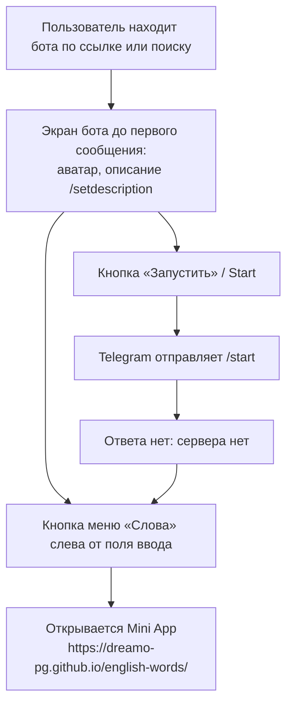

# 04. Бот в Telegram

> В исходном плане документации здесь были «Сценарии в чате»: команды, кнопки, ответы бота, напоминания. **В проекте этого нет**, поэтому раздел описывает, что на самом деле видит пользователь в чате и почему.

## Что такое «бот» в этом проекте

Бот — это **только запись в BotFather**:
- username и имя бота;
- описание и строка «о боте»;
- аватар;
- **Menu Button** типа `web_app` с URL приложения и подписью.

Серверного кода нет: в репозитории нет ни одного обработчика апдейтов, вебхука или long polling. Токен бота **нигде не используется**: ни в коде, ни в CI, ни в секретах GitHub Actions (в `deploy.yml` и `check.yml` секретов нет). Проверено чтением [`.github/workflows/`](../../.github/workflows/) и `grep` по репозиторию.

Какой именно username у боевого бота, **не проверено**: в репозитории он не записан, доступа к BotFather у документации нет.

## Что видит пользователь в чате

| Элемент | Откуда | Текст |
|---|---|---|
| Описание (видно до первого сообщения) | BotFather `/setdescription` | Рекомендация README: «Тренажёр английских слов B1–B2. Нажмите кнопку «Слова» внизу, чтобы начать.» Реально установленный текст **не проверен** |
| «О боте» в профиле | BotFather `/setabouttext` | README: «одна строка для профиля бота», конкретного текста нет |
| Аватар | BotFather `Edit Botpic` | `assets/bot-icon.png` 512×512: знак МФА «шва» (ə) светлым штрихом на бирюзовом `#007C99`. Исходник `assets/bot-icon.svg`. Тот же знак — фавикон в `index.html` |
| Кнопка меню | BotFather `Bot Settings → Menu Button` | Подпись по README: «Слова». URL: `https://dreamo-pg.github.io/english-words/` **со слэшем на конце** |

Как настроить всё это по шагам — [12](12-configuration.md#botfather).

## Команды

**Команд нет.** Ни `/start`, ни `/help`, ни других. Список команд в BotFather (`/setcommands`) README не упоминает. Если он задан, команды будут видны в меню `/`, но отвечать на них некому.

| Действие пользователя | Что происходит | Что меняется в данных |
|---|---|---|
| `/start` (или кнопка «Запустить») | Сообщение уходит боту, ответа нет | Ничего |
| Любой текст, стикер, файл | Ответа нет | Ничего |
| Кнопка меню «Слова» | Открывается Mini App | Ничего до загрузки; дальше см. [06](06-mini-app-screens.md) |
| Inline-режим `@бот …` | Не настроен в коде, ответа нет | Ничего |

Так работает с самого начала проекта. В аудите это находка **B-01** («У бота нет обработчика: на `/start` и любые сообщения ответа нет»). Решение — хватает описания в BotFather, отдельный обработчик писать не обязательно.

## Кнопки и `callback_data`

**Нет.** Бот не отправляет сообщений, значит, не отправляет и inline-клавиатур. `callback_data` в проекте не встречается (`grep -rn callback_data` — 0 совпадений).

Mini App тоже **не отправляет данных в чат**: `WebApp.sendData`, `switchInlineQuery`, `openTelegramLink` не вызываются (проверено по [`src/telegram/types.ts`](../../src/telegram/types.ts), там перечислено всё, чем приложение пользуется из SDK).

## Напоминания о занятиях

**Напоминаний нет.** Бот не может писать первым без сервера, а сервера нет. В Mini App тоже нет локальных уведомлений: Telegram их не предоставляет.

| Вопрос | Ответ |
|---|---|
| Когда приходят | Никогда |
| Кому | — |
| Как отключить | Нечего отключать |
| Что напоминает о занятиях | Только счётчики на главной: «на повторе» и «дней подряд» с огоньком. И иконка на домашнем экране, если пользователь её добавил |

Как можно было бы сделать — [16](16-issues-backlog.md#идеи).

## Если в будущем появится сервер

Это не план, а напоминание из аудита и из самого устройства хранения:

- **Проверка `initData` по HMAC обязательна с первого эндпоинта** (AUDIT.md, раздел 2.1: «Если в будущем появится бэкенд, проверка `initData` по HMAC станет обязательной с первого же эндпоинта»).
- Прогресс сейчас лежит в CloudStorage, сервер его **не видит**. CloudStorage доступен только из Mini App. Для напоминаний «у вас 12 слов на повторе» серверу понадобится либо своя копия прогресса (Mini App будет её отправлять), либо напоминания без цифр.
- Боту, который пишет первым, нужен `/start` от пользователя (иначе Telegram не даст написать). Сейчас многие пользователи `/start` уже нажали, это даёт основу для рассылки, но список их `chat_id` нигде не сохранён.
