# 06. Mini App: экраны

Все экраны — React-компоненты в [`src/screens/`](../../src/screens/). Переключает их одно состояние `screen` в [`src/App.tsx`](../../src/App.tsx), роутера и URL-адресов у экранов нет. Тексты всех экранов дословно собраны в [05](05-ui-texts.md).

**Скриншоты** сделаны 2026-11-12 в headless Chrome (390×844, масштаб 2) на собранном приложении (`vite preview`). Обычный браузерный режим использует `localStorage`; для экранов, которые бывают только в Telegram, подставлялся мок `window.Telegram.WebApp` (скрипт снятия лежал вне репозитория). В настоящем клиенте Telegram сверху будет его шапка с кнопкой «назад» или «закрыть» и меню «⋯», на скриншотах её нет. **На живых клиентах iOS, Android и Desktop экраны не сверялись.**

## Карта экранов и переходов

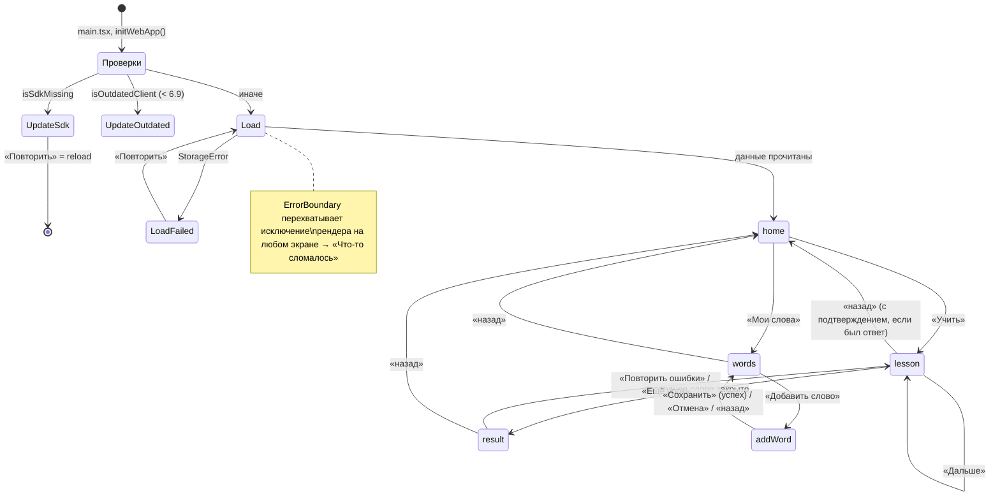

| `screen` | Компонент | Как попасть | «Назад» (BackButton) |
|---|---|---|---|
| — | `UpdateScreen reason="sdk"` | Telegram открыл приложение (`#tgWebApp…` в адресе), а SDK не загрузился | — |
| — | `UpdateScreen reason="outdated"` | Версия Mini Apps < 6.9 | — |
| — | `LoadScreen` | При каждом запуске, пока читается хранилище | — |
| `home` | `HomeScreen` | После загрузки; «назад» с других экранов | Скрыта |
| `lesson` | `LessonScreen` | «Учить», «Ещё урок», «Повторить ошибки» | На главную. Если дан хоть один ответ — сначала подтверждение |
| `result` | `ResultScreen` | Урок закончен | На главную |
| `words` | `WordsScreen` | «Мои слова»; после сохранения своего слова | На главную |
| `addWord` | `AddWordScreen` | «Добавить слово» | В «Мои слова» |
| — | `ErrorBoundary` | Исключение при рендере | — |

Если `screen` равен `lesson` или `result`, но урока в памяти нет, показывается главная (`renderScreen` в `App`).

## Общая раскладка

Компонент `Screen` ([`src/components/ui.tsx`](../../src/components/ui.tsx)):
- фон `#FAF9F5`, поля 24 px;
- необязательная **шапка** (`header`) остаётся на месте, пока прокручивается содержимое (поиск в «Моих словах», полоса прогресса урока);
- **содержимое** прокручивается внутри экрана, сама страница неподвижна (`.scroll`, `overscroll-behavior: contain`);
- необязательный **подвал** (`footer`) с главными кнопками отделён линией сверху, снизу у него отступ `20px + env(safe-area-inset-bottom)`;
- высота всего окна берётся из `viewportStableHeight` Telegram (CSS-переменная `--app-height`), а не из `100vh`.

Над экраном может стоять **плашка** (`Banner`) на розовом фоне `#FFE7E3` с одной кнопкой ([05](05-ui-texts.md#плашки-сверху-banner-в-app)). Во время урока плашка о синхронизации не показывается.

Все кнопки свои. **MainButton и SecondaryButton Telegram не используются**: они оформлены Telegram и ломают дизайн (README).

## Служебные экраны

### Проверка клиента: `UpdateScreen`

| Состояние | Скриншот |
|---|---|
| SDK не загрузился (`reason="sdk"`): заголовок «Не удалось подключиться к Telegram», кнопка «Повторить» перезагружает страницу. Ничего не читается и не пишется | 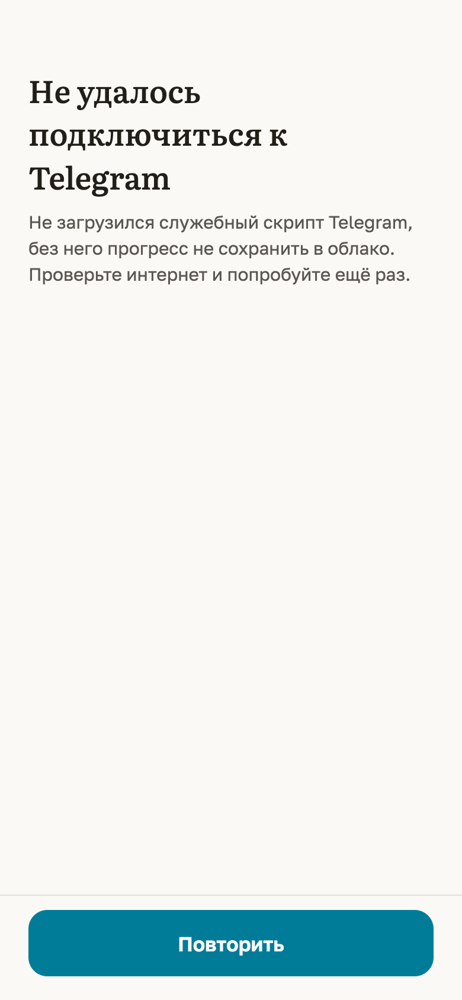 |
| Клиент старше 6.9 (`reason="outdated"`): «Обновите Telegram» с версией клиента. Кнопок нет, приложение дальше не идёт | 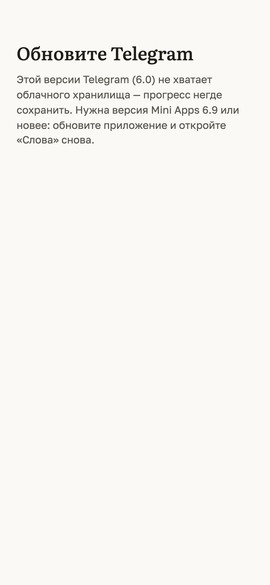 |

Зачем: без CloudStorage прогресс некуда сохранить. Честнее остановить пользователя, чем дать пройти урок и потерять его (находки T-03 и R-03).

### Загрузка: `LoadScreen`

| Состояние | Что видно |
|---|---|
| Первые 400 мс | Пустой экран цвета фона (чтобы короткая загрузка не мигала) |
| Дольше 400 мс | Серым «Загружаю прогресс…» |
| Ошибка | «Не удалось загрузить прогресс», пояснение и кнопка «Повторить» (заново `loadAll`) |

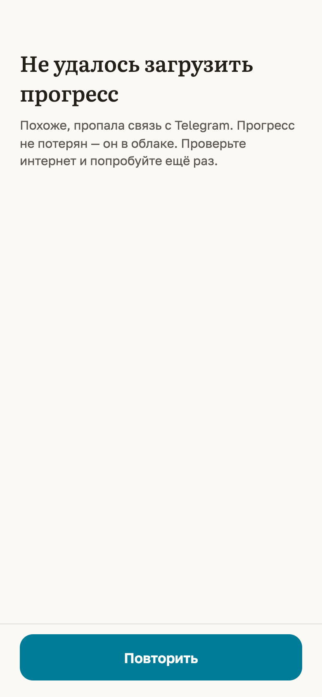

Пока данные не прочитаны, главная не показывается вообще, поэтому урок на пустом прогрессе начать невозможно (находка D-01).

### Аварийный экран: `ErrorBoundary`

Оборачивает всё приложение в [`src/main.tsx`](../../src/main.tsx). При исключении во время рендера показывает «Что-то сломалось», «Сохранённый прогресс не пострадал. Перезапустите приложение.» и кнопку «Перезапустить» (`location.reload()`). Ошибка пишется в консоль как `[app] ошибка рендера`. Скриншота нет: вызвать падение рендера без правки кода не удалось.

## Главная

Компонент `HomeScreen`. Назначение: показать прогресс и выбрать, что учить.

| Элемент | Поведение |
|---|---|
| Заголовок «Слова» | Шрифт Literata |
| «Мои слова» | Переход на `words` |
| Три счётчика | «знаю» (зелёный), «на повторе» (бирюзовый), «дней подряд» (тёплый, с огнём). Считаются по текущему пулу ([02](02-learning-logic.md#сводка-на-главной-summarizepool-progress-stats)) |
| Плашка «На домашний экран» | Только если клиент 8.0+, `checkHomeScreenStatus` ответил `missed` и пользователь не нажимал крестик. «Добавить» открывает системный диалог; плашку убирает только событие `homeScreenAdded`, поэтому при отмене диалога она остаётся. Крестик скрывает её навсегда (`settings.homeScreenHidden`) |
| НАБОР | Четыре карточки из `SETS`. Активная с бирюзовой рамкой и тенью |
| УРОВЕНЬ | Сегменты только для уровней, где есть слова (сейчас B1, B2) |
| СЛОВ В УРОКЕ | 10 / 20 / 30 |
| «Учить» | В подвале. Неактивна (серая), если пул пуст, и тогда над ней подсказка |

Любое изменение набора, уровня или размера сразу ставится в очередь записи `settings` и отправляется.

| Состояние | Скриншот |
|---|---|
| Первый запуск, браузер | 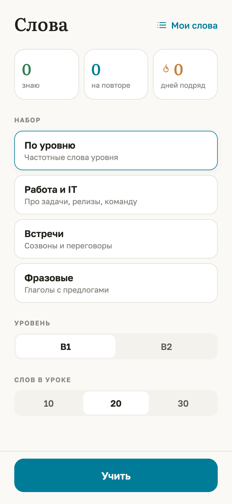 |
| После урока: «на повторе» 0, серия 1 | 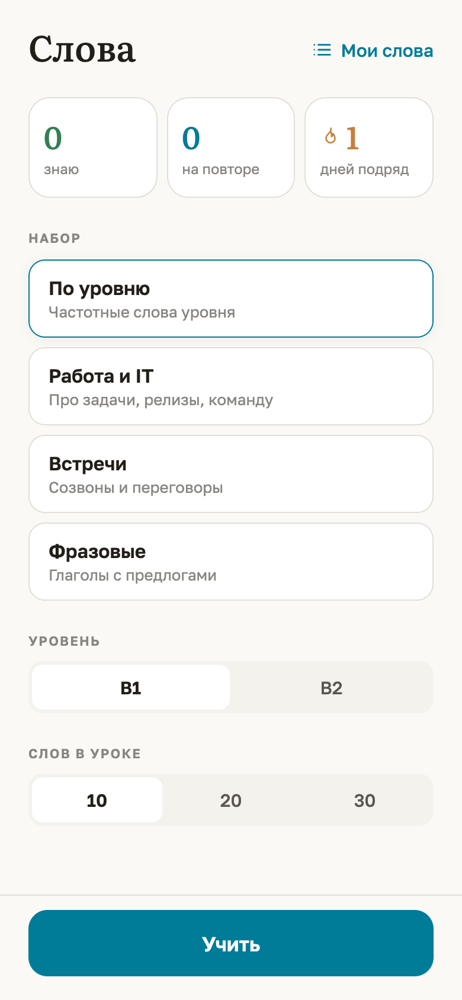 |
| В Telegram 8.0+ с плашкой «На домашний экран». Серия 1 здесь — из неотправленной очереди на устройстве, оставшейся от предыдущего сценария съёмки: так приложение и должно себя вести | 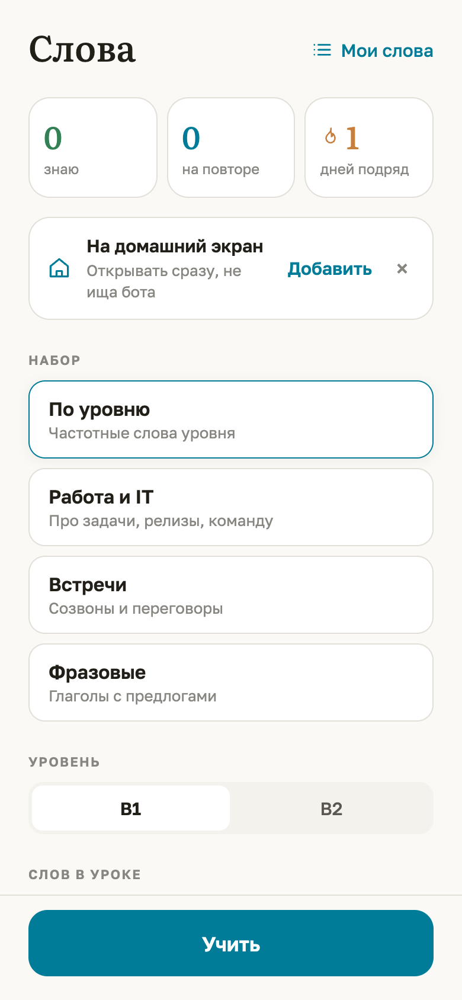 |

Пустое состояние (пул пуст) сейчас недостижимо из интерфейса: у B1 и B2 во всех наборах есть слова, а других уровней в переключателе нет. Возможно оно, только если в настройках сохранён набор, которого больше нет в `SETS` (например, после переименования набора в коде): тогда `poolFor` вернёт пустой массив.

## Урок

Компонент `LessonScreen`. Один экран, две фазы.

### Фаза «вопрос»

- Сверху полоса прогресса: тонкая бирюзовая полоса и счётчик `done / total`. Ширина анимируется за 180 мс.
- Английское слово крупно (46 px, если до 8 символов; 38 — до 12; 32 — до 16; иначе 27), транскрипция, справа круглая кнопка звука 44×44.
- Чипы части речи и уровня.
- Четыре варианта высотой 62 px. При нажатии пальцем рамка бирюзовая (`pressed`).
- Появление слова — плавное (`step-in`, 180 мс).
- Звук сам **не** играет: только по кнопке.

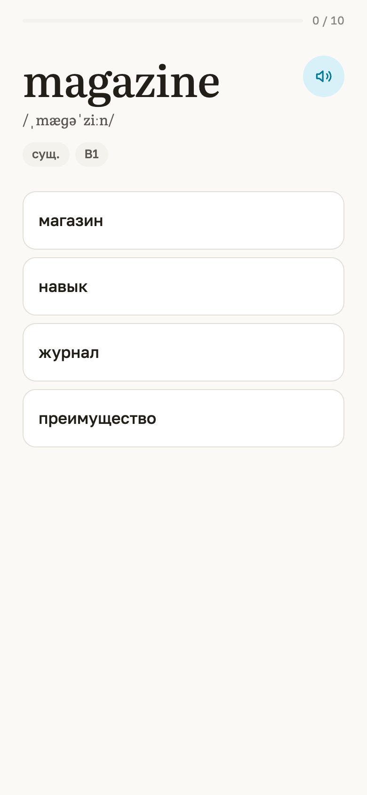

### Фаза «ответ»

После нажатия на вариант (повторные нажатия игнорируются):
- haptic `success` или `error`;
- вверху «✓ Верно» зелёным или «✕ Не угадал» красным;
- варианты сжимаются до 47 px: верный — зелёный фон и ✓, выбранный неверный — розовый фон и ✕, остальные бледные;
- снизу выезжает **карточка слова** (`card-in`, 220 мс, сдвиг на 16 px и проявление);
- слово **один раз произносится** автоматически (`speak(word.en)`);
- в подвале «Дальше». Защёлка `sent` не даёт двойным нажатием пропустить следующее слово.

| Верно | Неверно | Ложный друг (выбран «магазин») |
|---|---|---|
| 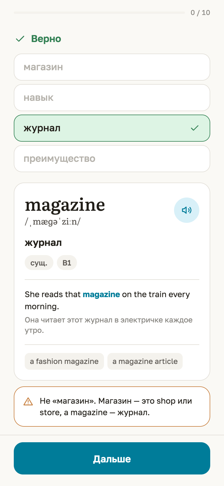 | 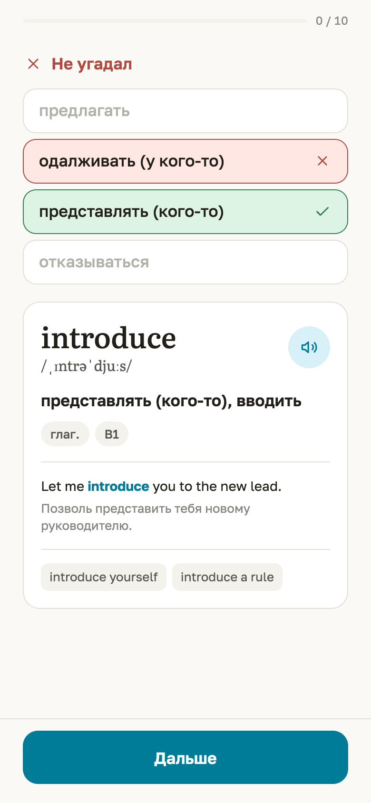 | 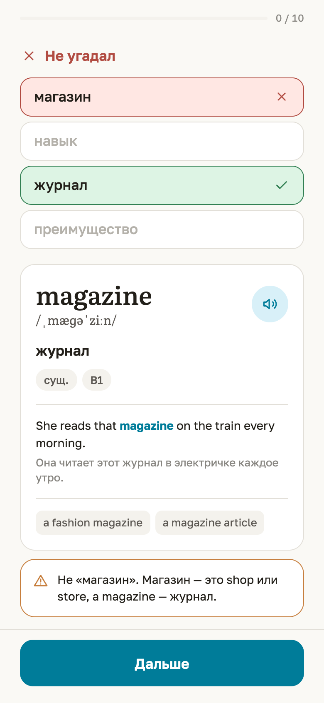 |

Счётчик `done` растёт только после «Дальше», поэтому на экране ответа он ещё старый.

### Карточка слова (`WordCard`)

Пять слоёв ([`src/components/WordCard.tsx`](../../src/components/WordCard.tsx)):
1. слово (30 px), транскрипция, кнопка звука;
2. значения через запятую, чипы части речи, уровня и «своё»;
3. пример, в котором слово выделено бирюзовым жирным, и перевод примера серым;
4. сочетаемость серыми «пилюлями» и «Близкие: …»;
5. только у ложных друзей — отдельный блок с тёплой рамкой и значком ⚠.

Пустые слои не рисуются: у своего слова без примера нет третьего слоя, у слов без сочетаемости и синонимов — четвёртого.

### Выход из урока

- «Назад», пока не дано ни одного ответа (`position = 0`), — сразу на главную.
- После первого ответа — `showConfirm` «Выйти из урока? Ответы этого урока не сохранятся.». «OK» — на главную, урок потерян; «Отмена» — остаётся.
- Пока идёт урок с ответами, включено `enableClosingConfirmation`: Telegram спросит подтверждение при закрытии или сворачивании окна свайпом.

## Итог урока

Компонент `ResultScreen`.

| Элемент | Поведение |
|---|---|
| Кольцо 168 px | Дуга по доле слов «с первого раза». Цвет: ≥ 80 % зелёный, ≥ 50 % бирюзовый, ниже тёплый. В центре число, под ним «из N» |
| Строка | «Урок пройден без единой ошибки» или «С первого раза — X из N» |
| Серия | «🔥 N дней подряд», если серия больше 0 |
| Разбор ошибок | По строке на слово с ошибкой: слово, транскрипция, значения, часть речи, точки усвоения (уже после обновления — обычно одна красная), кнопка звука 36 px |
| «Повторить ошибки» | Только при ошибках. Урок ровно из этих слов |
| «Ещё урок» | Всегда. «Тихая» белая кнопка, если есть «Повторить ошибки», иначе акцентная |

| С ошибками | Без ошибок (после «Повторить ошибки») | С плашкой «не всё сохранено» |
|---|---|---|
| 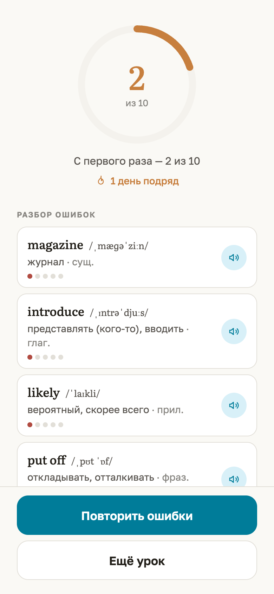 | 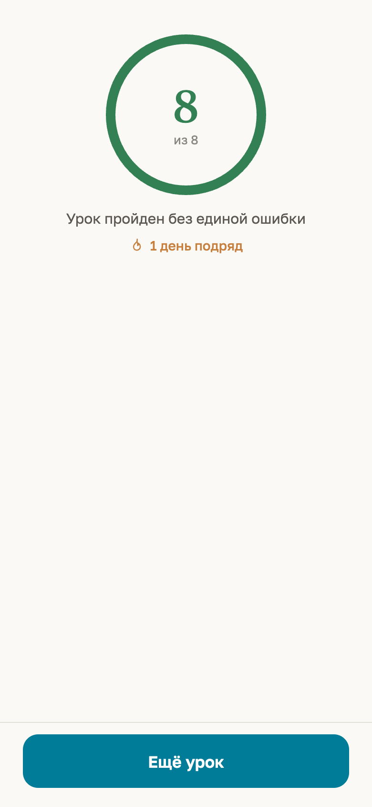 | 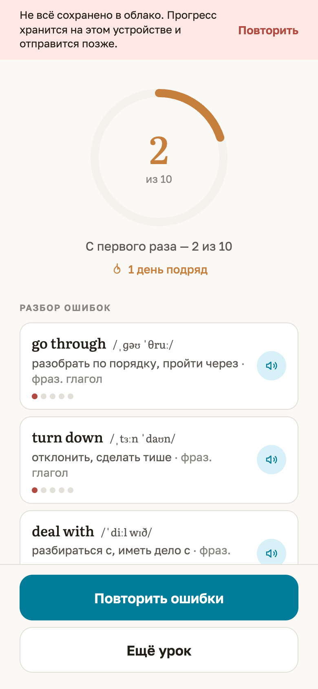 |

К моменту показа итога прогресс уже применён и поставлен в очередь записи. Если запись не удалась, сверху плашка с «Повторить».

## Мои слова

Компонент `WordsScreen`. Показывает **весь словарь** (оба уровня, все наборы) плюс свои слова, независимо от выбранного на главной набора и уровня.

| Элемент | Поведение |
|---|---|
| Поиск (в закреплённой шапке) | Подстрока без учёта регистра в `en` или любом значении `ru` |
| Фильтр | «Все»; «Учу» — запись есть и `box < 5`; «Знаю» — `box ≥ 5`; «Трудные» — `errors ≥ 2` |
| Счётчик | «N слово/слова/слов» или «Ничего не нашлось» |
| Строка | Слово, транскрипция, чип «своё», значения и часть речи, справа 5 точек усвоения (у новых все серые) |
| Нажатие на строку | Раскрывает под ней карточку слова (одновременно открыта одна). Повторное нажатие сворачивает |
| «Удалить слово» | Только под карточкой своего слова. Подтверждение → удаление |
| «Показать ещё» | Список показывается порциями по 40. Новый поиск или фильтр сбрасывает до 40 |
| «Добавить слово» | В подвале, переход на `addWord` |

Порядок: словарь в порядке файлов (B1-01 … B2-06, внутри — как в файле), затем свои слова по алфавиту.

| Список | Раскрытая карточка | Пустой фильтр | Своё слово |
|---|---|---|---|
| 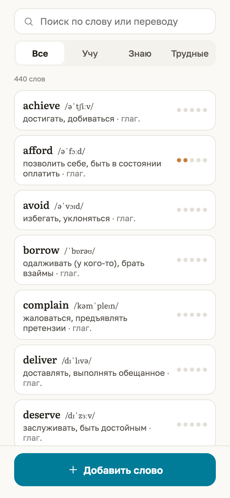 |  | 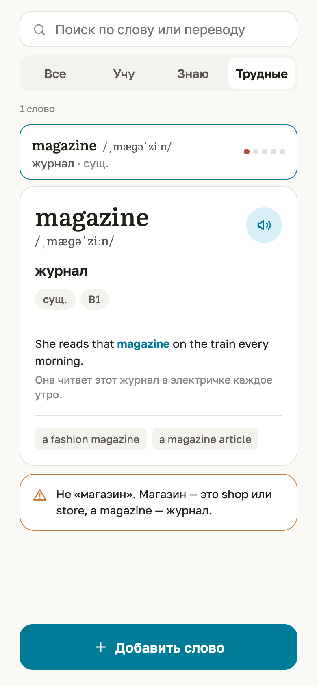 | 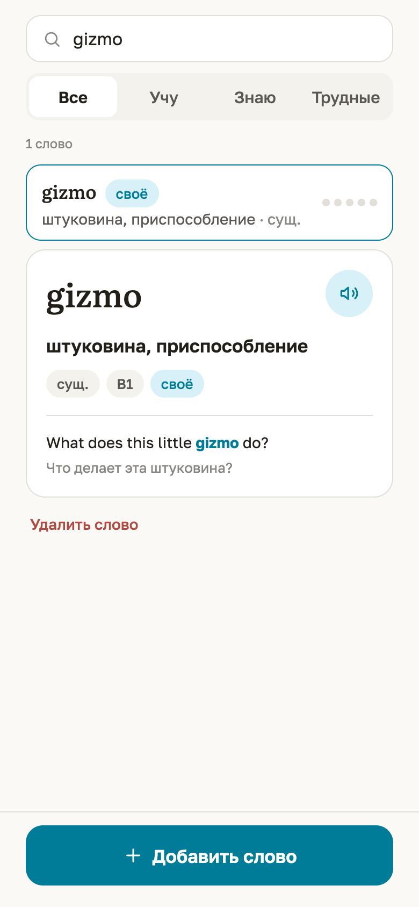 |

## Своё слово

Компонент `AddWordScreen`.

- Поля: «Слово» (Literata, до 60), «Перевод» (до 120, подсказка про запятые), выбор части речи (по умолчанию «сущ.»), «Пример» и «Перевод примера» (по 200, многострочные).
- Внизу пояснение, что уровень берётся из настроек.
- «Сохранить» неактивна, пока пусты слово или перевод. Во время сохранения — «Сохраняю…».
- Успех: возврат в «Мои слова», слово в списке, чип «своё».
- Ошибка: красный текст над кнопками и haptic `error`; введённое не сбрасывается.
- «Отмена» и «назад» ведут в «Мои слова» без вопроса, введённое теряется.

| Пустая форма | Ошибка «Заполните слово и перевод.» |
|---|---|
| 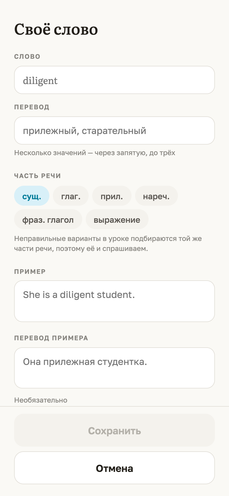 | 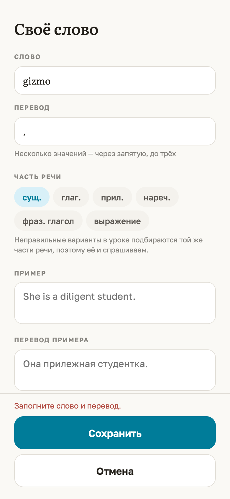 |

## Кнопка «назад» и подтверждения

- **Только нативная `BackButton` Telegram**, своей кнопки «назад» в интерфейсе нет. На главной она скрыта, на остальных экранах показана (`setBackButton` в [`src/telegram/webapp.ts`](../../src/telegram/webapp.ts), эффект в `App`).
- В браузере BackButton нет, вместо неё работает клавиша **Escape** (для отладки, ничего не рисуется).
- Подтверждения — нативный `showConfirm` с 6.2, иначе `window.confirm`: выход из урока и удаление своего слова ([05](05-ui-texts.md#системные-диалоги-telegram-showconfirm)).
- `enableClosingConfirmation` — только на время урока с ответами.
- Вертикальные свайпы, сворачивающие окно, отключены (`disableVerticalSwipes`, 7.7+): иначе свайп по списку вариантов сворачивал бы приложение.

## Озвучка

- [`src/lib/speech.ts`](../../src/lib/speech.ts): `window.speechSynthesis`, язык `en-US`, скорость 0.95.
- Голос выбирается по порядку: локальный `en-US`, любой `en-US`, любой `en-*`, иначе голос по умолчанию. Список голосов приходит асинхронно, при `voiceschanged` выбор повторяется.
- Перед каждой фразой предыдущая обрывается (`cancel()`).
- Где звучит: автоматически один раз после ответа в уроке; по кнопке 🔊 в вопросе урока, на карточке слова и в разборе ошибок.
- Если `speechSynthesis` нет (бывает во вебвью Telegram), `canSpeak = false`, и **кнопки звука не рисуются**, ошибок нет.
- Каких голосов нет на конкретных устройствах, **не проверено**.

## Тактильный отклик

`haptic` в `webapp.ts`, с версии 6.1, вне Telegram молча выключен.

| Вызов | Метод Telegram | Где |
|---|---|---|
| `haptic.success()` | `notificationOccurred('success')` | Верный ответ |
| `haptic.error()` | `notificationOccurred('error')` | Неверный ответ; ошибка сохранения своего слова |
| `haptic.select()` | `selectionChanged()` | Смена сегмента, набора, части речи (только при смене), раскрытие строки в «Моих словах» |
| `haptic.tap()` | `impactOccurred('light')` | Главные кнопки (`PrimaryButton`), «Мои слова», звук, «Добавить» на плашке, «Показать ещё», «Удалить слово», кнопка плашки |

## Анимации

Всего три движения ([`src/theme/global.css`](../../src/theme/global.css), `ui.tsx`):

| Что | Анимация | Длительность |
|---|---|---|
| Новое слово в уроке | `step-in`: проявление | 180 мс, ease-out |
| Карточка слова после ответа и в «Моих словах» | `card-in`: сдвиг на 16 px вверх и проявление | 220 мс, cubic-bezier(0.22, 0.61, 0.36, 1) |
| Полоса прогресса урока | `transition: width` | 180 мс |

При системной настройке «уменьшить движение» (`prefers-reduced-motion: reduce`) `step-in` и `card-in` отключаются.

## Оформление

### Светлая и тёмная тема

**Тема всегда светлая**, `themeParams` и `colorScheme` Telegram намеренно игнорируются (README, [`src/theme/colors.ts`](../../src/theme/colors.ts)). В тёмном Telegram:
- шапка Telegram перекрашивается в `#FAF9F5` (`setHeaderColor`, 6.9+);
- фон окна `#FAF9F5` (`setBackgroundColor`, 6.1+);
- нижняя системная полоса `#FAF9F5` (`setBottomBarColor`, 7.10+); на более старых клиентах она может остаться тёмной;
- `<meta name="color-scheme" content="light">` и `color-scheme: light` на `html`: поля ввода и скроллбары тоже светлые.

Как именно это выглядит на живом тёмном клиенте, **не проверено** (AUDIT.md, T-01: «тёмной темы по-прежнему нет: это осознанное решение»).

### Цвета (`colors`)

| Токен | Цвет | Где |
|---|---|---|
| `bg` | `#FAF9F5` | Фон, шапка и нижняя полоса Telegram |
| `surface` | `#FFFFFF` | Карточки, варианты, поля |
| `sunken` | `#F4F2ED` | Подложка сегментов, чипы, неактивная кнопка |
| `line` | `#E2DFD8` | Рамки, разделители, серые точки |
| `ink` | `#221F19` | Основной текст |
| `ink2` | `#5B5752` | Вторичный текст, транскрипция |
| `muted` | `#888681` | Подписи, подсказки |
| `accent` | `#007C99` | Бирюзовый: кнопки, ссылки, выделение слова, box 3–4 |
| `accentBg` | `#D8F0F8` | Фон кнопки звука, чип «своё» |
| `ok` / `okBg` | `#328053` / `#DDF4E4` | Верно, box 5, «знаю» |
| `bad` / `badBg` | `#B14B41` / `#FFE7E3` | Неверно, box 1, плашки, «Удалить слово» |
| `warm` | `#C77F3E` | Серия, ложный друг, box 2 |
| `inkDisabled` | `#B4B1AA` | Неактивный текст |

`accent`, `ok` и `bad` построены в OKLCH с одинаковой светлотой (L ≈ 0.54), комментарий в коде просит не заменять их стандартными синим, зелёным и красным.

Радиусы (`radius`): чип 8, сегмент 12, строка 14, кнопка 16, карточка 18, «пилюля» 999.

### Шрифты

- **Literata Variable** (засечки, оптический размер) — слова, заголовки, числа, транскрипция.
- **Golos Text** 400/500/600/700 — интерфейс.
- Оба — пакеты `@fontsource`, отдаются с того же домена, браузер по `unicode-range` качает только нужные поднаборы (латиница, кириллица; latin-ext для символов МФА). К Google Fonts запросов нет.

### Иконки

Контурные SVG 24×24 со штрихом 1.7 ([`src/components/icons.tsx`](../../src/components/icons.tsx)): `IconSound`, `IconCheck`, `IconCross`, `IconSearch`, `IconPlus`, `IconWarn`, `IconFlame`, `IconList`, `IconHome`. Эмодзи в интерфейсе нет.

### Масштаб и доступность

- Масштаб жестом разрешён (из `viewport` убраны `maximum-scale=1, user-scalable=no`, находка U-02); двойной тап по кнопкам не зумит (`touch-action: manipulation`).
- `aria-label`: «Произнести» у кнопки звука, «Не сейчас» у крестика плашки; `role="status"` у плашки, `role="alert"` у ошибки формы.
- Варианты ответа — настоящие `<button>`, доступны с клавиатуры. Цифровых горячих клавиш (1–4) нет.
