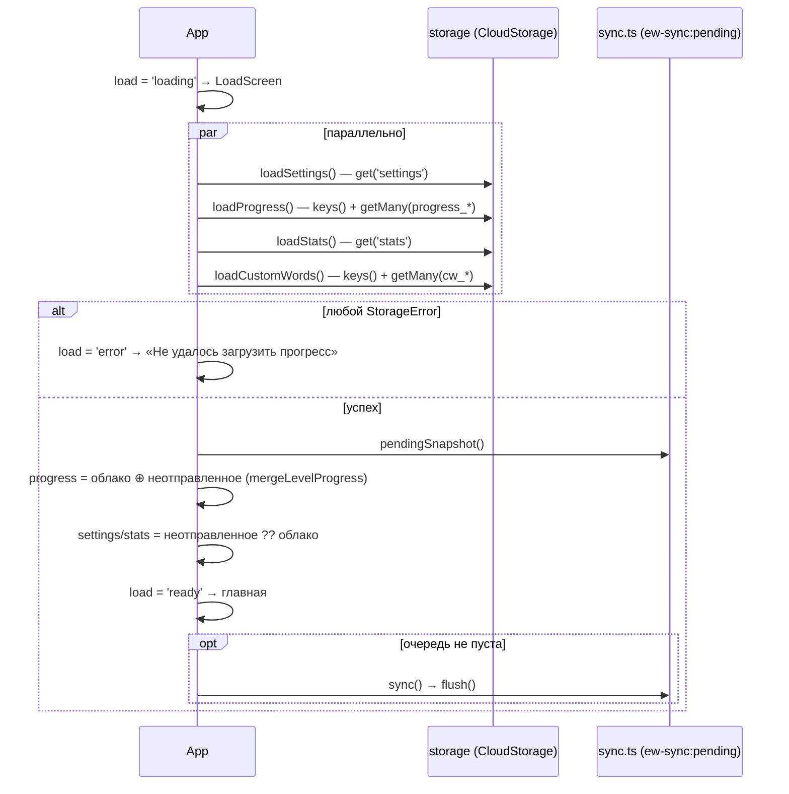

# 07. Mini App: техника

## Фреймворк и подход

- **React 18.3.1** + **TypeScript 5.9.3** (strict), сборщик **Vite 5.4.21** с `@vitejs/plugin-react` 4.7.0. Точные версии всего стека — [09](09-architecture.md#стек-и-точные-версии).
- Одностраничное приложение без роутера: экран — одно значение `useState` в `App`.
- **Без библиотек состояния, UI-китов и CSS-фреймворков.** Стили инлайновые (`style={{…}}`), цвета и радиусы берутся из одного файла токенов [`src/theme/colors.ts`](../../src/theme/colors.ts). Глобальный CSS ([`src/theme/global.css`](../../src/theme/global.css)) — только база, анимации и класс `.scroll`.
- **Без SDK-обёрток вроде `@telegram-apps/sdk`**: используется официальный скрипт `telegram-web-app.js` и своя тонкая обёртка [`src/telegram/webapp.ts`](../../src/telegram/webapp.ts).
- Зависимостей рантайма четыре: `react`, `react-dom`, `@fontsource-variable/literata`, `@fontsource/golos-text`.

## Структура фронтенда

```text
index.html                 подключает telegram-web-app.js и /src/main.tsx; color-scheme light; фавикон
src/
  main.tsx                 токены → CSS-переменные, initWebApp(), шрифты, <StrictMode><ErrorBoundary><App/>
  App.tsx                  всё состояние приложения, загрузка, синхронизация, переходы, урок
  telegram/
    types.ts               типы используемой части Telegram.WebApp
    webapp.ts              init, высота, BackButton, haptic, confirm, closing confirmation, storage, home screen
  theme/
    colors.ts              colors, radius, font, applyCssVariables()
    global.css             база, анимации card-in / step-in, .scroll
  components/
    ui.tsx                 Screen, SectionTitle, PrimaryButton, Segmented, ProgressDots, LessonProgress, Chip, Banner
    WordCard.tsx           карточка слова + highlight()
    SoundButton.tsx        круглая кнопка озвучки
    icons.tsx              9 SVG-иконок
    ErrorBoundary.tsx      аварийный экран
  screens/
    HomeScreen.tsx  LessonScreen.tsx  ResultScreen.tsx  WordsScreen.tsx  AddWordScreen.tsx
    LoadScreen.tsx  UpdateScreen.tsx
  lib/
    settings.ts  leitner.ts  lesson.ts  progress.ts  sync.ts  stats.ts  speech.ts  customWords.ts
  data/
    words.ts  b1-01…b1-05.ts  b2-01…b2-06.ts
```

### Компоненты

| Компонент | Файл | Пропсы | Назначение |
|---|---|---|---|
| `App` | `App.tsx` | — | Корень: состояние, загрузка, очередь, экраны |
| `Frame` | `App.tsx` | `banner`, `children` | Плашка сверху, экран на оставшуюся высоту |
| `ErrorBoundary` | `components/ErrorBoundary.tsx` | `children` | Ловит исключения рендера |
| `Screen` | `components/ui.tsx` | `header?`, `footer?`, `children` | Раскладка экрана |
| `SectionTitle` | `ui.tsx` | `style?` | Подзаголовок 11 px uppercase |
| `PrimaryButton` | `ui.tsx` | `onClick`, `disabled`, `tone: 'accent' \| 'quiet'` | Кнопка 56 px, haptic `tap` |
| `Segmented<T>` | `ui.tsx` | `options`, `value`, `onChange` | Сегментированный переключатель, haptic `select` |
| `ProgressDots` | `ui.tsx` | `box`, `size = 7` | 5 точек усвоения |
| `LessonProgress` | `ui.tsx` | `done`, `total` | Полоса прогресса урока |
| `Chip` | `ui.tsx` | `tone: 'sunken' \| 'accent'` | «Пилюля» |
| `Banner` | `ui.tsx` | `text`, `action`, `onAction` | Плашка о сбое |
| `WordCard` | `components/WordCard.tsx` | `word` | Карточка слова |
| `SoundButton` | `components/SoundButton.tsx` | `text`, `size = 44` | Кнопка звука; не рисуется без `speechSynthesis` |
| `Icon*` | `components/icons.tsx` | `size`, `color`, `style` | Иконки |
| `HomeScreen` и др. | `screens/*` | см. [06](06-mini-app-screens.md) | Экраны |
| `Option` | `screens/LessonScreen.tsx` | `label`, `height`, `state`, обработчики | Вариант ответа: `idle`, `pressed`, `correct`, `wrong`, `dim` |
| `Stat` | `screens/HomeScreen.tsx` | `value`, `label`, `tone`, `flame?` | Счётчик на главной |
| `ScoreRing`, `MistakeRow` | `screens/ResultScreen.tsx` | — | Кольцо счёта, строка разбора |
| `Field` | `screens/AddWordScreen.tsx` | `label`, `value`, `multiline`, `maxLength`… | Поле формы |

## Управление состоянием

Всё состояние живёт в `App` (`useState`), экраны получают данные и колбэки пропсами. Контекстов, редьюсеров и сторонних сторов нет.

| Состояние | Тип | Начальное | Что это |
|---|---|---|---|
| `screen` | `'home' \| 'lesson' \| 'result' \| 'words' \| 'addWord'` | `'home'` | Текущий экран |
| `settings` | `Settings` | `DEFAULT_SETTINGS` | Набор, уровень, размер урока, `homeScreenHidden` |
| `progress` | `Progress` | `{}` | Прогресс по уровням |
| `stats` | `Stats` | `EMPTY_STATS` | Статистика |
| `lesson` | `LessonState \| null` | `null` | Текущий или последний урок (нужен итогу) |
| `custom` | `Word[]` | `[]` | Свои слова |
| `homeScreenStatus` | `'unsupported' \| 'unknown' \| 'added' \| 'missed'` | `'unsupported'` | Статус домашнего экрана |
| `load` | `'loading' \| 'ready' \| 'error'` | `'loading'` | Стадия загрузки |
| `syncFailed` | `boolean` | `false` | Последний `flush` не удался |
| `notice` | `string \| null` | `null` | Текст плашки об ошибке удаления |
| `retryTimer` | `useRef<number>` | — | Таймер повтора синхронизации |

Производные (`useMemo`): `allWords = WORDS + custom`, `levels` (уровни со словами), `level` (действующий уровень), `pool = poolFor(allWords, settings.set, level)`, `summary = summarize(pool, progress, stats)`, `repeatWords = lessonMistakes(lesson)`.

Локальное состояние экранов: `LessonScreen` — `chosen`, `pressed`, `sent`; `WordsScreen` — `query`, `filter`, `limit`, `openId`; `AddWordScreen` — поля формы, `saving`, `error`; `LoadScreen` — `slow`.

Модульное состояние вне React: очередь `pending`, счётчик `seq` и цепочка `chain` в [`src/lib/sync.ts`](../../src/lib/sync.ts); выбранный голос в `speech.ts`.

## Telegram WebApp API

SDK подключается в `index.html` синхронным `<script src="https://telegram.org/js/telegram-web-app.js">` **без версии** (всегда последняя версия Telegram). Обёртка `webapp.ts` берёт `window.Telegram.WebApp` и считает, что приложение в Telegram, только если `platform !== 'unknown'` (в обычном браузере SDK тоже грузится и отдаёт `platform: 'unknown'`, `version: '6.0'`).

Все вызовы обёрнуты в `try/catch` (`safe`) и проверяют версию (`since(v)` → `isVersionAtLeast`).

| Что вызывается | С версии | Где | Зачем |
|---|---|---|---|
| `ready()` | любая | `initWebApp` | Сообщить, что приложение готово |
| `expand()` | любая | `initWebApp` | Развернуть окно на всю высоту |
| `disableVerticalSwipes()` | 7.7 | `initWebApp` | Свайп по списку не сворачивает окно |
| `setHeaderColor('#FAF9F5')` | 6.9 (hex) | `initWebApp` | Светлая шапка |
| `setBackgroundColor('#FAF9F5')` | 6.1 | `initWebApp` | Светлый фон |
| `setBottomBarColor('#FAF9F5')` | 7.10 | `initWebApp` | Светлая нижняя полоса |
| `onEvent('viewportChanged')` | любая | `initWebApp` | Пересчитать `--app-height` из `viewportStableHeight` |
| `BackButton.show/hide/onClick/offClick` | 6.1 | `setBackButton` | Нативная «назад» |
| `HapticFeedback.*` | 6.1 | `haptic` | Тактильный отклик |
| `showConfirm` | 6.2 | `confirmAction` | Подтверждения |
| `enableClosingConfirmation` / `disableClosingConfirmation` | 6.2 | `setClosingConfirmation` | Подтверждение закрытия во время урока |
| `CloudStorage.getItem/getItems/setItem/removeItem/getKeys` | 6.9 (проверяется общим `MIN_VERSION`) | `storage` | Хранилище |
| `checkHomeScreenStatus` | 8.0 | `checkHomeScreen` | Есть ли иконка на домашнем экране. Если ответа нет 1,5 с — `'unknown'` |
| `addToHomeScreen` | 8.0 | `addToHomeScreen` | Системный диалог добавления |
| `onEvent('homeScreenAdded')` | 8.0 | `onHomeScreenAdded` | Скрыть плашку только при реальном добавлении |
| `isVersionAtLeast`, `version`, `platform`, `viewportStableHeight` | любая | обёртка | Проверки |

**Не используется:** `initData` и `initDataUnsafe` (приложение не знает пользователя), `themeParams`, `colorScheme`, `MainButton`, `SecondaryButton`, `SettingsButton`, `sendData`, `openLink`, `openTelegramLink`, `showPopup`, `showAlert`, `requestFullscreen`, `DeviceStorage`, `SecureStorage`, `LocationManager`, `BiometricManager`, `CloudStorage.removeItems` (объявлен в типах, не вызывается).

Константа `MIN_VERSION = '6.9'`. `isOutdatedClient = в Telegram && !isVersionAtLeast('6.9')`. `isSdkMissing = SDK нет && в hash есть tgWebAppData|tgWebAppPlatform|tgWebAppVersion`.

### Поведение вне Telegram (фолбэк)

| Возможность | В Telegram | В браузере |
|---|---|---|
| Хранилище | CloudStorage | `localStorage` с префиксом `ew:` |
| Назад | BackButton | Клавиша Escape |
| Подтверждения | `showConfirm` | `window.confirm` |
| Haptic | `HapticFeedback` | ничего |
| Высота | `viewportStableHeight` | `window.innerHeight`, пересчёт на `resize` |
| Домашний экран | 8.0+ | `'unsupported'`, плашки нет |

## Хранение и синхронизация

### Где что лежит

| Данные | В Telegram | В браузере | Копия на устройстве |
|---|---|---|---|
| Прогресс по словам | CloudStorage `progress_<уровень>[_N]` | `localStorage` `ew:progress_…` | В очереди `ew-sync:pending`, пока не записано |
| Статистика | CloudStorage `stats` | `ew:stats` | То же |
| Настройки | CloudStorage `settings` | `ew:settings` | То же |
| Свои слова | CloudStorage `cw_<id>` | `ew:cw_<id>` | Нет: пишутся сразу, без очереди |
| Очередь несохранённого | `localStorage` WebView `ew-sync:pending` | `localStorage` `ew-sync:pending` | — |

Форматы ключей — [08](08-storage-contract.md). **Сервера нет**, поэтому синхронизация между устройствами — это синхронизация CloudStorage самим Telegram: все устройства одного аккаунта видят одно хранилище бота. `localStorage` у каждого устройства (и у каждого WebView) свой.

### Слой `storage` (`webapp.ts`)

- Методы: `get`, `getMany`, `set`, `remove`, `keys`. Все возвращают промис и **при любом сбое бросают `StorageError`**: ошибка колбэка, исключение, таймаут, пустой ответ `getItems`/`getKeys`, неподтверждённый `setItem`/`removeItem`.
- Каждый вызов к CloudStorage — до **3 попыток** с паузами 300 и 600 мс; у каждой попытки **таймаут 8 с** (`TIMEOUT_MS`, `ATTEMPTS`).
- Перед записью проверяется ключ (`/^[A-Za-z0-9_-]{1,128}$/`) и длина значения (≤ 4096). Нарушение — `StorageError` без отправки.
- Пустая строка из `getItem` считается «ключа нет» (`null`).
- В браузере обращения к `localStorage` обёрнуты (приватный режим может бросить) и тоже дают `StorageError`.

Смысл: «сбой» и «пусто» различаются. До аудита сбой чтения превращался в пустой прогресс, и следующий урок затирал облако (D-01, критическая находка).

### Загрузка при запуске (`App.loadAll`)



Испорченный JSON в `settings` или `stats` даёт значения по умолчанию (`DEFAULT_SETTINGS`, `EMPTY_STATS`), в отличие от сбоя чтения. Испорченные записи прогресса и своих слов пропускаются поштучно.

### Запись: очередь `sync.ts`

1. **`enqueue(change)`** кладёт изменения в `pending`:
   - `levels[уровень] = { progress: весь уровень из памяти, removed: удалённые id, seq }`;
   - `stats = { value, seq }`, `settings = { value, seq }`;
   - каждое изменение получает новый номер `seq`, счётчик переживает перезапуск (`maxSeq`);
   - вся очередь сразу копируется в `localStorage['ew-sync:pending']` (если не получилось, работает и без копии).
2. **`flush()`** — отправка. Вызовы выстраиваются в цепочку `chain` и **не пересекаются**. Порядок внутри: все уровни, затем `stats`, затем `settings`.
   - Для уровня — `saveLevelProgress(level, progress, removed)`:
     1. `keys()` → ключи этого уровня → `getMany` → текущая версия уровня в облаке;
     2. `mergeLevelProgress(облако, своё, removed)`: по каждому слову побеждает больший `lastDay`, при равенстве своё; удалённые id выбрасываются;
     3. `serializeLevelProgress` режет на шарды ≤ 4096 символов, они пишутся по одному;
     4. только после записи всех новых шардов удаляются лишние хвостовые (`progress_b1_2`, если теперь шардов два).
   - Если за время записи этот же элемент снова изменился (`seq` другой), он остаётся в очереди.
   - Ошибка одного элемента не останавливает остальные. Результат `{ ok, merged }`.
3. **`absorb(current, merged)`** вливает слитую из облака версию в память: подтягиваются записи с других устройств, а изменённое в памяти за время записи не теряется.

`settings` и `stats` пишутся целиком, без слияния: **побеждает последняя запись**. Значит, серия и счётчики с двух устройств, на которых занимались в один день, могут перезаписать друг друга (остаточное ограничение из аудита, [16](16-issues-backlog.md)).

### Когда отправляется очередь

| Триггер | Где |
|---|---|
| Сразу после `enqueue` (конец урока, смена настройки, удаление своего слова) | `App.finishLesson`, `patchSettings`, `removeCustomWord` |
| После успешной загрузки, если очередь с прошлого запуска не пуста | `App.loadAll` |
| Через 20 с после неудачи (`RETRY_MS`), снова и снова, пока не получится | `App.sync` |
| Возврат в приложение (`visibilitychange` → `visible`), если очередь не пуста | эффект в `App` |
| Кнопка «Повторить» на плашке | `Banner` |

### Свои слова

Пишутся **напрямую**, без очереди: `saveCustomWord` → `storage.set('cw_<id>', JSON)`. Ошибка показывается в форме, слово не добавляется. Удаление — `storage.remove('cw_<id>')`; при ошибке плашка, слово остаётся. Прогресс удалённого слова убирается из памяти и через очередь (`removed`) из облака.

### Несколько устройств: что гарантируется

| Сценарий | Результат |
|---|---|
| Урок на телефоне, затем урок на компьютере | Оба урока в прогрессе: перед записью уровень перечитывается и сливается |
| Два урока одновременно на двух устройствах | По каждому слову остаётся запись с более поздним днём; при одинаковом дне — того, кто записал последним |
| Нет сети в конце урока | Прогресс в памяти и в `ew-sync:pending`; плашка; досылается позже |
| Приложение закрыли до отправки | При следующем запуске на **этом же устройстве** очередь накладывается на облако и отправляется. На другом устройстве этого урока не будет, пока первое не откроют снова |
| `stats` / `settings` с двух устройств | Последняя запись побеждает |
| Своё слово удалили на одном устройстве, а на другом оно ещё в очереди прогресса | Запись прогресса может вернуться (остаточное ограничение) |

Проверяет это `npm run check:storage` ([`scripts/check-storage.mjs`](../../scripts/check-storage.mjs), 37 проверок на моке CloudStorage).

## Сборка

- `npm run build` = `tsc --noEmit && vite build` → `dist/`.
- `base: '/english-words/'` в [`vite.config.ts`](../../vite.config.ts): все пути в собранном `index.html` начинаются с `/english-words/`.
- Один JS-чанк, без code splitting и ленивой загрузки. Сервис-воркера и офлайн-кэша нет.

### Размер бандла

Сборка 2026-11-12 (`npm run build`):

| Файл | Размер | gzip |
|---|---|---|
| `assets/index-*.js` | 311,44 КБ | 103,72 КБ |
| из них словарь `src/data/*` (оценка: минифицированный `words.ts` отдельно) | ≈ 151 КБ | ≈ 43 КБ |
| `assets/index-*.css` (в основном `@font-face`) | 9,46 КБ | 1,59 КБ |
| Шрифты (39 файлов woff/woff2, все поднаборы) | ≈ 720 КБ всего | — |
| `dist/` целиком (41 файл в `assets` + `index.html`) | ≈ 1,0 МБ | — |

Браузер качает только нужные поднаборы шрифтов по `unicode-range`: на главной латиницу и кириллицу (Literata ≈ 110 + 62 КБ, Golos ≈ 12 КБ на начертание), в уроке ещё latin-ext для МФА. Словарь в бандле — осознанное решение (AUDIT.md: «словарь остаётся в бандле, это осознанно»).

Внешние запросы при запуске: только `telegram.org/js/telegram-web-app.js`. Шрифты, JS и CSS — с того же домена GitHub Pages.

## Качество кода

- `tsconfig.json`: `strict`, `noUnusedLocals`, `noUnusedParameters`, `noFallthroughCasesInSwitch`, `target: ES2020`, `moduleResolution: bundler`, `noEmit`.
- ESLint 9 ([`eslint.config.js`](../../eslint.config.js)): `@eslint/js` recommended + `typescript-eslint` recommended + `react-hooks` recommended; правило `no-unused-vars` разрешает имена с `_` (приём «выбросить поле деструктуризацией»).
- React `StrictMode`: в dev-режиме эффекты выполняются дважды. Это учтено (эффекты возвращают очистку).

## Указатель функций по модулям

Все функции и типы модулей, включая внутренние (не экспортируемые). Для экранов и компонентов — см. таблицу [компонентов](#компоненты).

### `src/App.tsx`

| Имя | Что делает |
|---|---|
| `RETRY_MS` | 20 000 мс до повтора неудачной синхронизации |
| `ScreenName` | Тип экрана |
| `sync()` | `flush()` очереди, `absorb` результата в `progress`, `syncFailed`, таймер повтора |
| `loadAll()` | Параллельная загрузка `settings`, `progress`, `stats`, своих слов; наложение неотправленной очереди; `load` |
| `patchSettings(patch)` | Обновить настройки в памяти, `enqueue({settings})`, `sync()` |
| `startLesson()` | `pickLessonWords` → `createLesson` → экран `lesson` |
| `startRepeat()` | Урок из `repeatWords` (`lessonMistakes`) |
| `finishLesson(state)` | Лейтнер по словам, `recordLesson`, `enqueue({levels, stats})`, `sync()`, экран `result` |
| `handleAnswer(correct)` | `answerCard`; если урок кончился — `finishLesson` |
| `addCustomWord(draft)` | `draftToWord` → `saveCustomWord`; возвращает текст ошибки или `null` |
| `removeCustomWord(word)` | Подтверждение → `deleteCustomWord` → убрать из `custom` и `progress` → `enqueue({removed})` |
| `renderScreen()` | Выбор компонента по `screen` |
| `Frame` | Плашка + экран |

### `src/telegram/webapp.ts`

| Имя | Экспорт | Что делает |
|---|---|---|
| `sdk`, `raw` | нет | `window.Telegram.WebApp`; `raw` — только если `platform !== 'unknown'` |
| `isTelegram` | нет | Признак настоящего Telegram |
| `isSdkMissing` | да | Telegram открыл, а SDK нет |
| `safe(fn)` | нет | Вызов в `try/catch` |
| `since(version)` | нет | `isVersionAtLeast` с защитой |
| `MIN_VERSION`, `isOutdatedClient`, `clientVersion` | да | `'6.9'`, клиент старше, строка версии для экрана «Обновите Telegram» |
| `initWebApp()` | да | Старт SDK, цвета, свайпы, высота, подписка `viewportChanged` |
| `applyHeight()` | нет | `--app-height` из `viewportStableHeight` или `innerHeight` |
| `setBackButton(handler)` | да | Показать BackButton с обработчиком или скрыть; возвращает очистку (`offClick` + `hide`); в браузере — Escape |
| `haptic` | да | `success`, `error`, `select`, `tap` |
| `confirmAction(message)` | да | `showConfirm` или `window.confirm` → `Promise<boolean>` |
| `setClosingConfirmation(on)` | да | Включить/выключить подтверждение закрытия |
| `LS_PREFIX`, `MAX_KEY`, `MAX_VALUE`, `KEY_RE`, `TIMEOUT_MS`, `ATTEMPTS` | частично | Лимиты и настройки хранилища |
| `StorageError` | да | Класс ошибки хранилища |
| `sleep(ms)` | нет | Пауза |
| `cloudCall(fn)` | нет | Колбэк CloudStorage → промис с таймаутом 8 с |
| `withRetry(op)` | нет | До 3 попыток, паузы 300/600 мс |
| `local(fn)` | нет | Обёртка `localStorage` → `StorageError` |
| `assertWritable(key, value)` | нет | Проверка ключа и длины до записи |
| `storage` | да | `get`, `getMany`, `set`, `remove`, `keys` |
| `checkHomeScreen()` | да | `checkHomeScreenStatus` (8.0+), через 1,5 с без ответа — `'unknown'` |
| `addToHomeScreen()` | да | Системный диалог (8.0+) |
| `onHomeScreenAdded(cb)` | да | `onEvent('homeScreenAdded')`; возвращает отписку через `offEvent` |

### `src/lib/sync.ts`

| Имя | Экспорт | Что делает |
|---|---|---|
| `PendingLevel`, `Pending` | нет | Типы очереди |
| `PENDING_KEY` | нет | `'ew-sync:pending'` |
| `readPending()` | нет | Прочитать очередь из `localStorage` при загрузке модуля |
| `maxSeq(p)` | нет | Продолжить нумерацию `seq` после перезапуска |
| `writePending()` | нет | Сохранить очередь в `localStorage` или удалить ключ, если пусто |
| `isEmpty()` / `hasPending()` | нет / да | Пуста ли очередь |
| `pendingSnapshot()` | да | Неотправленное для наложения на облако при запуске |
| `enqueue(change)` | да | Положить изменения в очередь |
| `FlushResult` | да | `{ ok, merged }` |
| `flush()` | да | Отправка, вызовы цепочкой |
| `doFlush()` | нет | Сама отправка: уровни → stats → settings |
| `absorb(current, merged, removed)` | да | Влить слитую версию облака в память |
| `__resetForTests()` | да | Только для `check:storage` |

### `src/lib/progress.ts`

| Имя | Экспорт | Что делает |
|---|---|---|
| `MAX_VALUE`, `PREFIX` | нет | 4096, `'progress_'` |
| `baseKey(level)`, `shardKey(level, i)` | нет | `progress_b1`, `progress_b1_<i>` |
| `levelOfKey(key)` | нет | Уровень по имени ключа или `null` |
| `parseLevelProgress(raw)` | да | Строка → `LevelProgress`, битые записи выбрасываются |
| `isNumeric`, `clampBox` | нет | Помощники разбора |
| `serializeLevelProgress(p)` | да | `LevelProgress` → массив строк ≤ 4096 |
| `shardIndex(level, key)` | нет | Номер шарда по ключу |
| `collect(keys, values)` | нет | Значения ключей → `Progress` |
| `loadProgress()` | да | Прочитать весь прогресс |
| `mergeLevelProgress(other, preferred, removed)` | да | Слияние по `lastDay` |
| `saveLevelProgress(level, local, removed)` | да | Перечитать, слить, записать шарды, удалить лишние |

### `src/lib/lesson.ts`

| Имя | Экспорт | Что делает |
|---|---|---|
| `LessonCard`, `LessonState` | да | Типы урока |
| `shuffle(items)` | нет | Фишер–Йетс |
| `poolFor(words, set, level)` | да | Пул урока |
| `REVIEW_FLIP` | нет | 30 |
| `pickLessonWords(pool, progress, size, day)` | да | Подбор слов урока |
| `norm(s)`, `optionText(word)` | нет | Нормализация текста; `ru[0]` |
| `buildCard(word, pool, all)` | да | Четыре варианта |
| `createLesson(words, pool, all)` | да | Новый урок |
| `currentCard(state)` | да | Текущая карточка |
| `answerCard(state, correct)` | да | Ответ, возврат ошибки в очередь |
| `isLessonOver(state)` | да | Конец урока |
| `lessonMistakes(state)` | да | Слова с ошибками |

### `src/lib/leitner.ts`, `stats.ts`, `settings.ts`

| Имя | Модуль | Что делает |
|---|---|---|
| `INTERVALS`, `MAX_BOX`, `DAY_EPOCH`, `DAY_MS` | leitner | Константы |
| `dayOf(ms, offset)`, `today()` | leitner | Номер дня |
| `WordProgress`, `LevelProgress`, `Progress` | leitner | Типы прогресса |
| `isDue`, `overdueBy`, `applyAnswer` | leitner | Лейтнер |
| `boxTone(box)` | leitner | Не используется (H-04) |
| `LessonRecord`, `Stats`, `EMPTY_STATS`, `HISTORY_LIMIT` | stats | Типы и начальное значение |
| `loadStats()`, `saveStats(stats)` | stats | Чтение и запись ключа `stats` |
| `LessonOutcome` | stats | `{ size, firstTry, answers, wrongAnswers }` — итог урока для `recordLesson` |
| `recordLesson(stats, outcome, day)` | stats | Счётчики, серия, история |
| `currentStreak(stats, day)` | stats | Серия с учётом пропуска |
| `Summary`, `summarize(pool, progress, stats, day)` | stats | Сводка для главной: `known`, `learning`, `due`, `fresh`, `streak` |
| `Settings`, `DEFAULT_SETTINGS` | settings | Тип и значения по умолчанию |
| `loadSettings()`, `saveSettings(s)` | settings | Чтение и запись ключа `settings` |

### `src/lib/customWords.ts`, `speech.ts`

| Имя | Модуль | Что делает |
|---|---|---|
| `CUSTOM_SET` | customWords | `'custom'` — набор-метка своих слов |
| `isCustom(word)` | customWords | `sets` содержит `custom` |
| `LIMITS`, `MAX_ID` | customWords | `{ en: 60, ru: 120, example: 200 }`, 64 |
| `CustomDraft` | customWords | Поля формы: `en`, `ru`, `exampleEn`, `exampleRu`, `pos`, `level` |
| `slugify(en)` | customWords | `id` из слова |
| `draftToWord(draft, taken)` | customWords | Форма → `Word` или `null` |
| `loadCustomWords()` | customWords | Все `cw_*`, отсортированы по `en` |
| `parseCustomWord(raw)` | customWords | Валидация записи |
| `saveCustomWord(word)` | customWords | `set('cw_<id>')` |
| `deleteCustomWord(id)` | customWords | `remove('cw_<id>')` |
| `synth`, `canSpeak` | speech | `speechSynthesis` и признак его наличия |
| `pickVoice()` | speech | Выбор голоса `en-US` → `en-*` |
| `speak(text)` | speech | Произнести |

### Прочее

| Имя | Где | Что делает |
|---|---|---|
| `applyCssVariables(root)` | `theme/colors.ts` | Токены → CSS-переменные `--c-*`, `--r-*`, `--font-*` |
| `wordSize(en)` | `screens/LessonScreen.tsx` | Размер шрифта слова: 46/38/32/27 |
| `plural(...)` | `ResultScreen.tsx`, `WordsScreen.tsx` | Склонение «день/дня/дней», «слово/слова/слов» |
| `highlight(sentence, en)` | `components/WordCard.tsx` | Выделение слова в примере |
