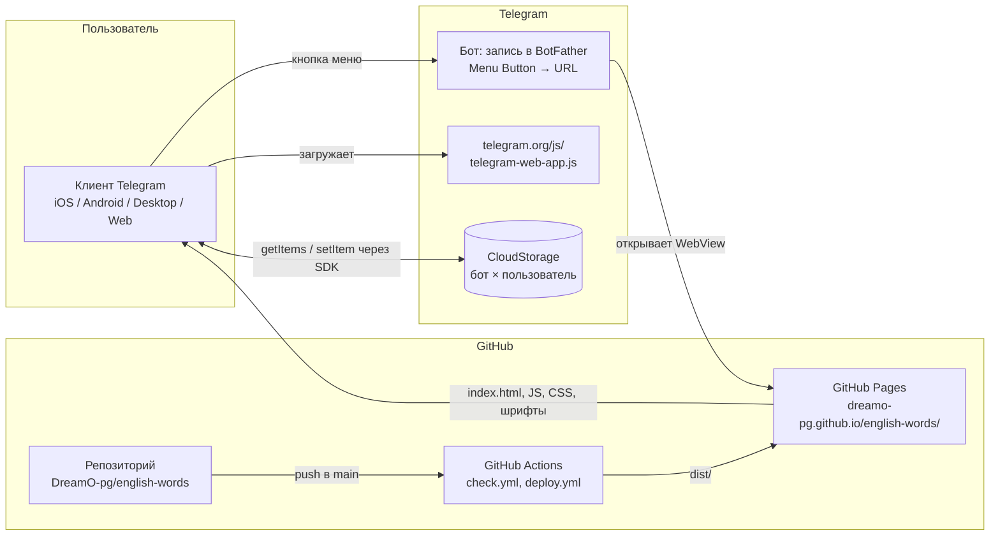
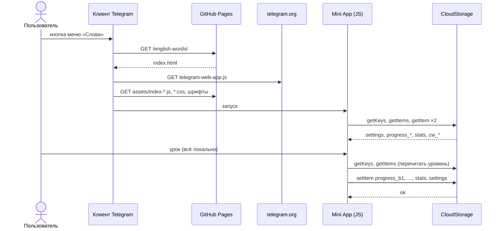

# 09. Архитектура

## Коротко



Три стороны, и ни одна не наша серверная:
1. **GitHub Pages** раздаёт статику.
2. **Telegram** запускает WebView по кнопке меню, даёт SDK и CloudStorage.
3. **Клиент пользователя** выполняет всё: подбор слов, Лейтнер, статистику, синхронизацию.

## Стек и точные версии

Версии из `package-lock.json` на 2026-11-12.

| Слой | Пакет | Диапазон в `package.json` | Установлено |
|---|---|---|---|
| UI | `react` | `^18.3.1` | 18.3.1 |
| UI | `react-dom` | `^18.3.1` | 18.3.1 |
| Шрифт | `@fontsource-variable/literata` | `^5.3.0` | 5.3.0 |
| Шрифт | `@fontsource/golos-text` | `^5.3.0` | 5.3.0 |
| Язык | `typescript` | `^5.6.3` | 5.9.3 |
| Сборка | `vite` | `^5.4.11` | 5.4.21 |
| Сборка | `@vitejs/plugin-react` | `^4.3.4` | 4.7.0 |
| Сборка проверок | `esbuild` | `^0.21.5` | 0.21.5 |
| Типы | `@types/react` | `^18.3.12` | 18.3.31 |
| Типы | `@types/react-dom` | `^18.3.1` | 18.3.7 |
| Линтер | `eslint` | `^9.39.5` | 9.39.5 |
| Линтер | `@eslint/js` | `^9.39.5` | 9.39.5 |
| Линтер | `typescript-eslint` | `^8.72.2` | 8.72.2 |
| Линтер | `eslint-plugin-react-hooks` | `^5.2.0` | 5.2.0 |
| Линтер | `globals` | `^16.5.0` | 16.5.0 |
| Telegram SDK | `telegram-web-app.js` | без версии, с `telegram.org` | всегда последняя |
| Рантайм сборки | Node.js | `engines: >=20` | CI: 22 (`actions/setup-node@v4`). Локально на момент написания: v20.10.0, npm 10.2.3 |

Минимальная версия Mini Apps у клиента: **6.9** (`MIN_VERSION`).

## Структура репозитория

```text
english-words/
├── .github/workflows/
│   ├── check.yml          CI на pull request в main: npm ci → npm run check → npm run build
│   └── deploy.yml         push в main / вручную: check → build → GitHub Pages
├── assets/
│   ├── bot-icon.svg       иконка бота (исходник, фигуры без шрифтов)
│   └── bot-icon.png       512×512 для BotFather
├── docs/handbook/         этот справочник (+ img/ со скриншотами)
├── public/.nojekyll       чтобы GitHub Pages не прогонял dist через Jekyll
├── scripts/
│   ├── check-words.mjs    проверка словаря
│   ├── check-engine.mjs   проверка движка (56 проверок)
│   ├── check-storage.mjs  проверка хранения на моке CloudStorage (37 проверок)
│   ├── engine-entry.ts    точка входа esbuild для check-engine (в приложение не попадает)
│   └── storage-entry.ts   точка входа esbuild для check-storage
├── src/                   приложение, см. 07
├── AUDIT.md               аудит 2026-11-10 и статус исправлений
├── CLAUDE.md              правило обновлять справочник в том же PR
├── README.md              запуск, деплой, BotFather, устройство
├── eslint.config.js
├── index.html             точка входа Vite; подключает SDK Telegram
├── package.json / package-lock.json
├── tsconfig.json
└── vite.config.ts         base: '/english-words/'
```

В `.gitignore`: `node_modules`, `dist`, `.DS_Store`, `*.local`, `.cache` (сюда esbuild кладёт собранные для проверок модули).

## Путь запроса: от нажатия кнопки до записи в облако

Классического «запроса к серверу» нет. Путь данных:

1. **Пользователь нажимает кнопку меню** в чате с ботом.
2. **Клиент Telegram** открывает WebView с URL из BotFather и добавляет в hash параметры запуска (`#tgWebAppData=…&tgWebAppVersion=…&tgWebAppPlatform=…`).
3. **GitHub Pages** отдаёт `index.html` (HTTPS, домен `github.io`).
4. **`index.html`** синхронно грузит `telegram-web-app.js` с `telegram.org`, затем модуль `/english-words/assets/index-*.js` и CSS.
5. **`main.tsx`**: CSS-переменные из токенов, `initWebApp()` (ready, expand, цвета, свайпы, высота), рендер `<ErrorBoundary><App/>`.
6. **`App`**: проверки `isSdkMissing` и `isOutdatedClient`, затем `loadAll()` — четыре параллельных чтения CloudStorage через SDK. SDK передаёт их клиенту Telegram, клиент — серверам Telegram.
7. **Урок** целиком в памяти: `pickLessonWords` → `createLesson` → `answerCard`… Сети нет.
8. **Конец урока**: `finishLesson` → `applyAnswer` по словам → `recordLesson` → `enqueue` (+ копия в `localStorage`) → `flush`.
9. **`flush`** для каждого уровня: `getKeys` → `getItems` (свежая версия облака) → слияние → `setItem` по шардам → `removeItem` лишних; затем `setItem('stats')`, `setItem('settings')`.
10. **Другое устройство** при следующем открытии читает то же CloudStorage и видит результат.



## Ключевые архитектурные решения

| Решение | Почему | Где записано |
|---|---|---|
| Без бэкенда, статика на GitHub Pages | Личный проект: ноль затрат и обслуживания, нечего взламывать | README: «без бэкенда, без аккаунтов» |
| Прогресс в CloudStorage | Синхронизация между устройствами без сервера и без регистрации | README, «Хранилище» |
| Словарь в бандле | 43 КБ gzip, зато ноль запросов и работает при плохой сети после загрузки | AUDIT.md, этап 5 |
| Один ключ прогресса на уровень + шарды | Все слова не влезают в 4096 символов; ключ на слово съел бы лимит в 1024 ключа | `progress.ts`, README |
| Запись в конце урока, а не после каждого ответа | Меньше обращений к облаку; цена — прерванный урок не сохраняется (отсюда подтверждение выхода) | README, `App.finishLesson` |
| Очередь с копией на устройстве и слияние перед записью | Не терять уроки при сбоях сети и не затирать другое устройство | AUDIT.md D-01…D-04 |
| Тема фиксированно светлая | Дизайн-решение; `themeParams` ломали бы палитру | README, `colors.ts` |
| Свои кнопки вместо MainButton | MainButton оформлен Telegram и ломает дизайн | README |
| Шрифты со своего домена | Скорость (нет блокирующего стороннего CSS) и приватность (Google не видит IP) | AUDIT.md P-01, P-02 |
| Без роутера | Одно окно, а не сайт; «назад» — нативная кнопка Telegram | `App.tsx` |

Журнал решений с датами — [15](15-history.md#журнал-продуктовых-и-технических-решений).
