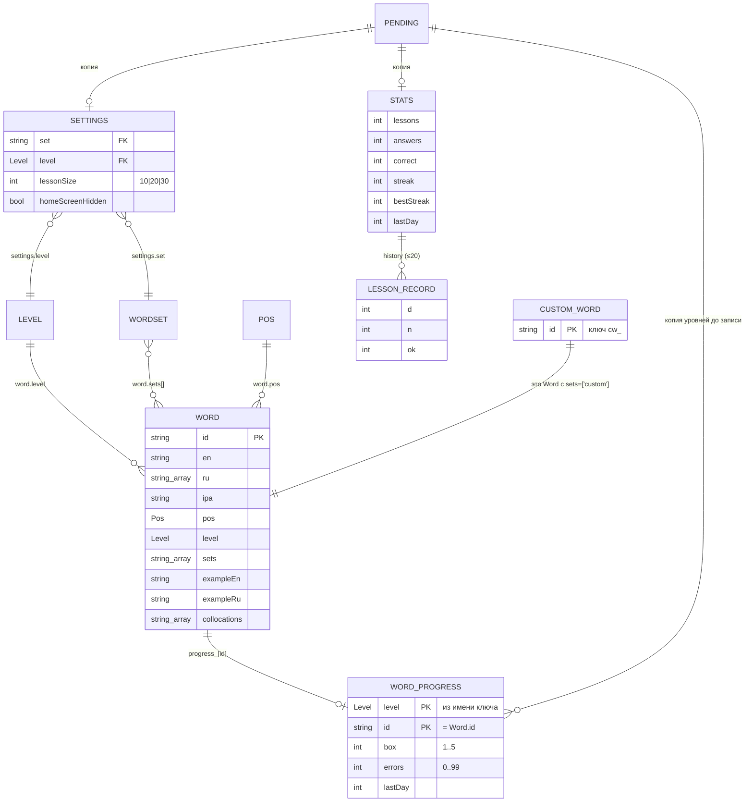

# 10. Данные

Таблиц и базы данных нет. Данные бывают двух видов:

1. **Статические** — словарь и справочники, зашиты в бандл (`src/data/`). У всех пользователей одинаковые, меняются только релизом.
2. **Пользовательские** — key-value в CloudStorage (в браузере — `localStorage`), у каждого пользователя свои.

Формат каждого ключа как контракт — в [08](08-storage-contract.md). Здесь — сущности, поля, смысл и связи.

## Сущности

### Статические (в коде)

| Сущность | Где | Ключ | Количество |
|---|---|---|---|
| `Word` (словарное слово) | `src/data/b*-*.ts`, массив `WORDS` | `id` | 440 |
| `WordSet` (набор) | `SETS` в `src/data/words.ts` | `id` | 4 (+ служебный `custom`) |
| `Level` (уровень) | `LEVELS` | значение | 5 (слова есть у 2) |
| `Pos` (часть речи) | `POS_LABEL` | значение | 6 |

### Пользовательские (в хранилище)

| Сущность | Ключ хранилища | Ключ сущности | Количество на пользователя |
|---|---|---|---|
| `Settings` | `settings` | — (одна) | 1 |
| `Stats` | `stats` | — (одна) | 1 |
| `LessonRecord` | внутри `stats.history` | порядок | ≤ 20 |
| `WordProgress` | `progress_<level>[_N]` | `(level, id слова)` | ≤ числа слов, которые пользователь видел |
| `Word` (своё слово) | `cw_<id>` | `id` | сколько добавил (лимит CloudStorage — 1024 ключа на всё) |
| `Pending` (очередь) | `localStorage['ew-sync:pending']` на устройстве | — | 0 или 1 на устройство |

Истории занятий по словам нет: хранится только текущее состояние слова (`box`, `errors`, `lastDay`) и короткая история последних 20 уроков без состава слов. Журнала ответов нет.

## Поля и смысл

### `Word`

| Поле | Тип | Обяз. | Смысл |
|---|---|---|---|
| `id` | string | да | Уникален среди словаря и своих слов. Связывает слово с прогрессом |
| `en` | string | да | Заглавная форма |
| `ru` | string[1..3] | да | Значения; `ru[0]` — спрашиваемое |
| `ipa` | string | да (пусто у своих) | МФА |
| `pos` | `Pos` | да | Часть речи |
| `level` | `Level` | да | Уровень; определяет шард прогресса |
| `sets` | string[] | да (может быть пусто) | Наборы; `custom` у своих |
| `exampleEn`, `exampleRu` | string | да (у своих могут быть пусты) | Пример |
| `collocations` | string[] | да (пусто у своих) | Сочетаемость |
| `synonyms` | string[] | нет | Близкие слова |
| `falseFriend`, `falseFriendRu` | string | нет, парой | Ложный друг |

### `WordProgress`

| Поле | Тип | Смысл |
|---|---|---|
| `box` | 1–5 | Коробка Лейтнера |
| `errors` | ≥ 0 (в хранилище ≤ 99) | Число уроков, в которых в слове была ошибка |
| `lastDay` | целое | День последнего изменения записи (от 2020-01-01, местная полночь). Обновляется при ошибке и при верном ответе в срок; верный ответ до срока его не трогает |

### `Settings`

| Поле | Тип | По умолчанию | Смысл |
|---|---|---|---|
| `set` | string | `'level'` | `id` набора |
| `level` | `Level` | `'B1'` | Выбранный уровень |
| `lessonSize` | 10 \| 20 \| 30 | 20 | Слов в уроке |
| `homeScreenHidden` | boolean? | нет | Плашку домашнего экрана закрыли |

### `Stats` и `LessonRecord`

| Поле | Тип | Смысл |
|---|---|---|
| `lessons` | int | Законченных уроков |
| `answers` | int | Всех ответов |
| `correct` | int | Верных ответов |
| `streak` | int | Серия на момент последнего урока |
| `bestStreak` | int | Лучшая серия |
| `lastDay` | int | День последнего урока |
| `history[].d` | int | День урока |
| `history[].n` | int | Слов в уроке |
| `history[].ok` | int | Слов с первого раза |

### `Pending`

| Поле | Смысл |
|---|---|
| `levels[L].progress` | Весь прогресс уровня L из памяти на момент постановки |
| `levels[L].removed` | `id` удалённых своих слов уровня L |
| `levels[L].seq`, `stats.seq`, `settings.seq` | Номер изменения; запись снимается с очереди, только если номер не изменился за время отправки |
| `stats.value`, `settings.value` | Полные объекты |

## Связи

Особенности связей:
- **Ссылочной целостности нет.** Запись прогресса может ссылаться на `id`, которого больше нет в словаре (слово удалили или переименовали в коде). Такая запись безвредна: в пул она не попадает, при записи уровня сохраняется.
- Прогресс слова ищется по паре `(word.level, word.id)`. Если слово в словаре **перенесли на другой уровень**, старая запись останется в старом шарде, а в новом уровне слово будет новым.
- Удаление своего слова удаляет и ключ `cw_<id>`, и запись прогресса (через `removed`).

## Миграции

**Механизма миграций нет**: нет номера версии схемы ни в одном ключе, нет кода «прочитать старый формат → записать новый». Вместо этого формат читается терпимо:

| Изменение в истории | Как переживается | Где |
|---|---|---|
| День стал считаться по местной полуночи вместо UTC (L-08, 2026-11-10) | Старые `lastDay` могут быть сдвинуты на 1 день. Безвредно, ничего не пересчитывается | `leitner.ts` `dayOf` |
| В `settings` мог остаться уровень без слов (A1/A2/C1 были в переключателе до L-01) | На экране подставляется первый уровень со словами, хранилище не переписывается до следующего изменения настроек | `App` `level` |
| В `Settings` появилось `homeScreenHidden` | Необязательное поле | `settings.ts` |
| Своё слово с битыми полями | Отбрасывается при чтении | `parseCustomWord` |
| Битые записи прогресса | Отбрасываются поштучно | `parseLevelProgress` |
| Неполные `settings`/`stats` | Дополняются значениями по умолчанию | `loadSettings`, `loadStats` |

Если понадобится настоящая миграция (например, смена формата `progress_*`), её придётся делать в клиенте: прочитать, преобразовать, записать при первом запуске новой версии. Сервера, который мог бы мигрировать данные всех пользователей, нет, а CloudStorage с сервера недоступен. Добавляя поле, проще сохранять обратную совместимость: старые клиенты должны продолжать читать новый формат (в WebView может оказаться закэшированная старая версия).
